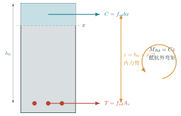

# 案例：把一根钢筋混凝土梁真正配出来

::: {.worked-question}
**钢筋混凝土梁抗弯设计**　已知设计弯矩是 $115\ \mathrm{kN\cdot m}$，到底先求什么？如果计算需要 $829\ \mathrm{mm^2}$ 钢筋，实际选了 $3\Phi20$，前面算过的受压区还能原样照抄吗？
:::

这道题容易被写成一串步骤：求 $x$，求 $A_s$，选钢筋，验算。学生照着做，也可能每一步都对；把例题稍微换一个问法，整条路又断了。问题不在公式太多，而在截面里的那两股力还没有真正立起来。

这一页保留讲解稿最好的地方：先看混凝土和钢筋怎样分工，再说明为什么选这个式子；同时把实际配筋后的复核补完整。正文、可打印文档和调参实验讲的是同一件事，各自做自己擅长的部分。

:::: {.content-visible unless-format="epub"}
::: {.case-actions}
[打开调参实验](../interactive/rc-bending-design-lab.html){.btn .btn-primary target="_blank"}
[下载标准 PDF](../assets/print/rc-bending-worked-example.pdf){.btn target="_blank"}
[下载 LaTeX / TikZ 源码](../assets/code/latex/rc-bending-worked-example.tex){.btn target="_blank"}
:::
::::

## 先看截面里谁在干活

混凝土承担上部压力，钢筋承担下部拉力。两股力大小相等、方向相反，又隔着一段距离，于是形成抵抗外弯矩的内力偶。

{fig-alt="钢筋混凝土矩形截面的等效受压区、受拉钢筋、压力、拉力和内力臂"}

在这套教学模型中，$x$ 指等效矩形压应力块深度：

$$
C=f_{cd}bx,\qquad T=f_{sd}A_s,\qquad C=T.
$$

压力和拉力之间的距离是

$$
z=h_0-\frac{x}{2},
$$

所以抵抗弯矩为

$$
M_{Rd}=f_{cd}bx\left(h_0-\frac{x}{2}\right).
$$

这幅图先回答“力从哪里来”；公式只是把图里的平衡写下来。

## 为什么先求 $x$

现在有两个未知量：$x$ 和 $A_s$。力平衡式里两个都在，弯矩式里却只有 $x$。所以先解弯矩式，不是因为课本规定了顺序，而是因为它是眼前未知量最少的关系。

| 能写下的关系 | 里面还剩几个未知量 | 现在适不适合先解 |
|---|---:|---|
| $f_{cd}bx=f_{sd}A_s$ | 2 | 先留着 |
| $M_{Ed}=f_{cd}bx(h_0-x/2)$ | 1 | 从这里开始 |
| $A_s=n\pi\phi^2/4$ | 根数、直径尚未选 | 后面把连续需求变成真实钢筋 |

这是一种很朴素、也很普遍的办法：问题很乱时，先找已知量最多、未知量最少的那种描述。解电路、查故障、排施工步骤，也常从这里打开缺口。

## 从需要的面积走到买得到的钢筋

本例采用 $b=250\ \mathrm{mm}$、$h=500\ \mathrm{mm}$、$a_s=40\ \mathrm{mm}$，所以 $h_0=460\ \mathrm{mm}$。把 $115\ \mathrm{kN\cdot m}$ 换成 $115\times10^6\ \mathrm{N\cdot mm}$，得到

$$
x_{\mathrm{req}}\approx79.30\ \mathrm{mm},\qquad
A_{s,\mathrm{req}}\approx829.0\ \mathrm{mm^2}.
$$

$829.0\ \mathrm{mm^2}$ 是连续的计算需求，实际却只能从一组根数和直径中选。若选 $3\Phi20$：

$$
A_{s,\mathrm{prov}}
=3\times\frac{\pi20^2}{4}
=942.48\ \mathrm{mm^2}.
$$

此时最容易犯的错，是拿实际钢筋面积 $942.48$ 去配原来的 $x=79.30$。这两者不是同一个平衡状态。钢筋拉力变了，混凝土压力也得跟着变：

$$
x_{\mathrm{prov}}
=\frac{f_{sd}A_{s,\mathrm{prov}}}{f_{cd}b}
\approx90.15\ \mathrm{mm},
$$

$$
M_{Rd}
=f_{cd}b x_{\mathrm{prov}}\left(h_0-\frac{x_{\mathrm{prov}}}{2}\right)
\approx129.05\ \mathrm{kN\cdot m}.
$$

在本例假定下，$M_{Rd}/M_{Ed}\approx1.122$。这里把它叫作离散选筋带来的**承载力余量**，不另外叫“安全系数”。可靠度并不藏在这一个比值里。

## 现在亲手改一个量

:::: {.content-visible unless-format="epub"}
::: {.interactive-block}
<iframe src="../interactive/rc-bending-design-lab.html" title="钢筋混凝土矩形梁抗弯设计调参实验" height="920" loading="lazy"></iframe>

先猜为什么要先求受压区，再改梁高、弯矩和钢筋。选完真实钢筋后，留意受压区是否重新计算；也可以保存两个方案，比较“梁加高”与“多放钢筋”谁更有杠杆。<a href="../interactive/rc-bending-design-lab.html" target="_blank">全屏打开实验</a>。

:::
::::

::: {.content-visible when-format="epub"}
网页版在这里安排了一次调参：先改梁高或弯矩，再把钢筋从 $3\Phi18$ 换成 $3\Phi20$，观察 $x_{\mathrm{prov}}$ 是否随实际配筋重新计算。EPUB 保留推导和图；交互、标准 PDF 与 LaTeX/TikZ 源码放在同一发布文件夹的网页版中。
:::

## $a_s$ 不是保护层

$a_s$ 是受拉钢筋重心到受拉边缘的距离。若保护层至箍筋外缘为 $c$，单层主筋可以先按

$$
a_s=c+\phi_{\mathrm{st}}+\frac{\phi_l}{2}
$$

估算。网页实验把“按讲稿固定 $a_s=40\ \mathrm{mm}$”与“由构造推导有效高度”分成两个模式，就是为了不把保护层、箍筋和主筋半径揉成一个含糊的数。

## 公式没有替我们回答的事

这一页只处理矩形截面单筋抗弯教学模型。它没有完成抗剪、裂缝、挠度、锚固和耐久性检查，也没有替项目选择现行规范、荷载组合与材料设计值。若所需或实际相对受压区深度超过本例给定的 $\xi_b$，意思是当前模型不再适用；不能把 $x$ 强行截到界限值，就宣布问题解决。

::: {.content-visible unless-format="epub"}

在网页里翻看标准 PDF

<object data="../assets/print/rc-bending-worked-example.pdf#view=FitH" type="application/pdf" width="100%" height="760">
  
当前浏览器没有内嵌 PDF 阅读器。<a href="../assets/print/rc-bending-worked-example.pdf" target="_blank">单独打开标准 PDF</a>。

</object>

:::

最后带走的不是“第几步套哪个式子”，而是两件事：先找最容易解开的基本关系；连续的计算需求一旦换成离散的真实方案，就回到平衡关系重新算一遍。换钢筋如此，换螺栓、换标准板厚、换设备型号，也一样。
