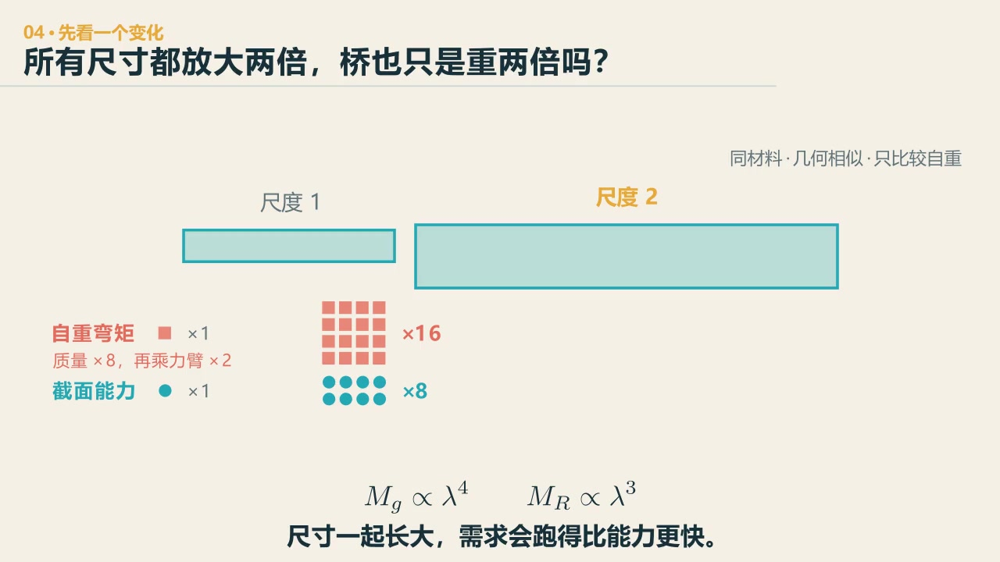
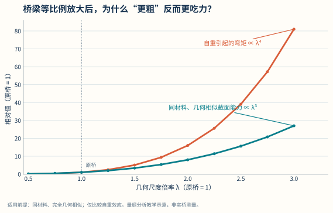

# 第 2 章　尺度：一张图纸，为什么不能画所有的桥

::: {.chapter-question data-term="尺度效应"}
把一座二十米的桥长、宽、高都放大两倍，它为什么可能先被自己的重量难住？
:::

我问过学生一个很省事的问题：能不能所有桥都用一张图纸？

二十米的时候按这张图做，四十米就把所有尺寸放大两倍；河更宽，再继续放大。像金箍棒一样，要多长就变多长。这个办法如果行得通，桥梁工程这门课可以少讲很多内容。

大家很快摇头。问到办法，学生七嘴八舌：轻质材料、分段、限重……"限重"是我没想到的——当时我说，这个我没想到。限重就是让过去的车少一点，因为桥的自重已经占了太大比例。

这个答案方向对，但还差一步：桥变重的时候，截面也变大，承载能力同样会增加。要比较的是——困难和能力，哪一个长得更快？

先问：把模型每个尺寸都放大两倍，桥的自重会只变成两倍吗？

::: {.content-visible when-format="html"}

  <video controls preload="metadata" data-poster="../assets/videos/manim/04-scale-law.jpg">
    <source src="../assets/videos/manim/04-scale-law.mp4" type="video/mp4">
  </video>
  
<a href="../assets/code/manim/bridge_mechanics_series.py" download>下载动画源码</a><a href="../assets/code/manim/mechanics_scenes.md" download>下载分镜说明</a><a href="../assets/code/manim/README.md" download>下载运行说明</a>

:::

::: {.content-visible when-format="epub"}

:::

::: {.interactive-block}
<iframe src="../interactive/fundamentals-lab.html?mode=scale" title="桥梁尺度律与数量级比较" height="710" loading="lazy"></iframe>

先看完增长速度的画面，再把外形放大，观察自重、弯矩需求与相似截面能力怎么一起变化。图是数量级判断，不是承载力验算；<a href="../interactive/fundamentals-lab.html?mode=scale" target="_blank">单独打开实验台</a>。

:::

<figure class="data-figure">

<figcaption>先比较增长速度，不急着代入某座桥。图中假定几何相似、材料不变，并只比较自重。</figcaption>

<a href="../assets/data-figures/01-scale-selfweight-capacity.csv" download>下载图中数据 CSV</a><a href="../assets/code/data-figures/generate_data_figures.py" download>下载绘图代码</a>

</figure>

这种不同的增长速度叫**尺度效应**：在几何相似、材料不变且只比较自重的简化条件下，自重弯矩随 \(\lambda^4\) 增长，抗弯能力随 \(\lambda^3\) 增长；它不能直接代替真实桥梁的验算。

## 我们先把它算错一次

课堂上我给了大家一根二十米的矩形简支梁，让不同同学按两倍、五倍、五十倍去放大，各自算自重弯矩和截面抗弯能力。我把自己的数也放上去，说："我这个数算的肯定是不对的，你们算完跟我核一下。"

这个地方保留错一次没有关系。我们要找的是指数，不是最后那串数字。

设跨度 \(L\)、截面宽 \(b\)、截面高 \(h\) 都按同一比例 \(\lambda\) 放大，只考虑梁的自重，材料密度和强度不变。单位长度自重

$$
q\sim bh\sim\lambda^2,
$$

简支梁在均布荷载下的跨中弯矩

$$
M_G=\frac{qL^2}{8}\sim\lambda^4,
$$

矩形截面的抗弯截面模量

$$
W=\frac{bh^2}{6}\sim\lambda^3,
$$

名义抗弯能力 \(M_R=fW\sim\lambda^3\)。

所有线性尺寸放大两倍，自重弯矩变成十六倍，名义抗弯能力变成八倍。能力也在增长，只是困难多走了一次方。对数坐标上，两条线都是直线，一条爬得快，一条爬得慢——不管什么结构，跨度一直增大，总有一个点，自重产生的弯矩会超过结构允许的承载能力，把结构压垮自己。这是尺度给我们的第一个教训。

课上我还讲过蜘蛛侠和哥斯拉。蜘蛛能举起自身很多倍的重物，超能力本质上来自它小；把它的体重按比例放大到人，能举起的重量就完全不一样了。电影公司问过研究复杂系统的科学家，哥斯拉那么大要怎么跑，科学家说它跑不起来——体重按体积的三次方长，骨骼截面只按二次方长，自重弯矩已经把它的骨头压垮了。生物不能按几何相似无限放大，桥也一样。

所以听到"放大十倍"，先别急着写 \(\lambda^4\)。要先问：谁放大了？谁没放大？荷载是沿长度、面积还是体积分布的？我们比较的能力又由什么控制？

## 学生给的办法，比我的目录好

算完以后，我没有马上列出梁桥、拱桥、斜拉桥、悬索桥。大家先想办法。

有人说换轻一点的材料——它减的是密度，减的是 \(q\)；有人说分段——跨度减半，弯矩就按平方降下来；有人说加高——高度增加，自重只多一次方，截面模量多两次方，有点像"以毒攻毒"；有人说把中间挖空——弯曲应力上下缘大、中间小，中间的料最不划算；有人说加个支座，把一个大跨度变成两个小跨度。这些办法里有些是学生先说的，有些是我顺着往下补的——课堂上我们把这些办法排了一遍，书上的截面、体系、材料，几乎都是在回答"跨度大了怎么办"。

有人还说过一个更远的办法：去月球上建。月球重力是地球的六分之一，同样的截面能跨得远得多。这个想法不算胡闹——它提醒我们，重力加速度也是公式里的一个变量。当然，跨得远以后又会带来新的问题：轻了，就薄了，振动和稳定会追上来。

## 桥不是越大越好

数据也在说话。美国乔治亚州四十多万座桥的统计里，超过五十米的只有大约百分之一，百分之九十九的桥跨度都在五十米以下。梁桥的极限跨度最小，却是最常用的——小跨度时它简单、便宜、施工成熟。

课上还说过一句：不需要建大跨度桥梁，就不要建。如果一定要建，就得用非常多的创新设计。工程不是纪录比赛，找到了跨过去的办法，还要问这个地方有没有需求，造价、维护和环境代价值不值得。

顺带一提，前几年有同学读了《规模》那本书，读完说看不太懂。这很正常——那本书借"不同量按不同指数增长"的眼光看城市和生物，和桥梁这里由明确几何与力学假设推出的 \(\lambda^4/\lambda^3\) 不是一回事。能带走的只有那个问法：规模变了，哪个量长得快，哪个量长得慢，原来的办法什么时候开始不够用。

::: {.chapter-method}
**不只问“变大了多少”，要问“谁长得更快”。** 动物、飞行器、数据中心和组织一旦放大，也要先找那个比能力长得更快的代价。
:::

### 留给自己的一个动作

拿同一根梁，分别做两种假设：①所有尺寸一起放大两倍；②只把跨度放大两倍。不必代具体数字，只写每个量的倍率。然后说明：你第一次看到"四次方"时，是不是默认了第二种情况？

---
