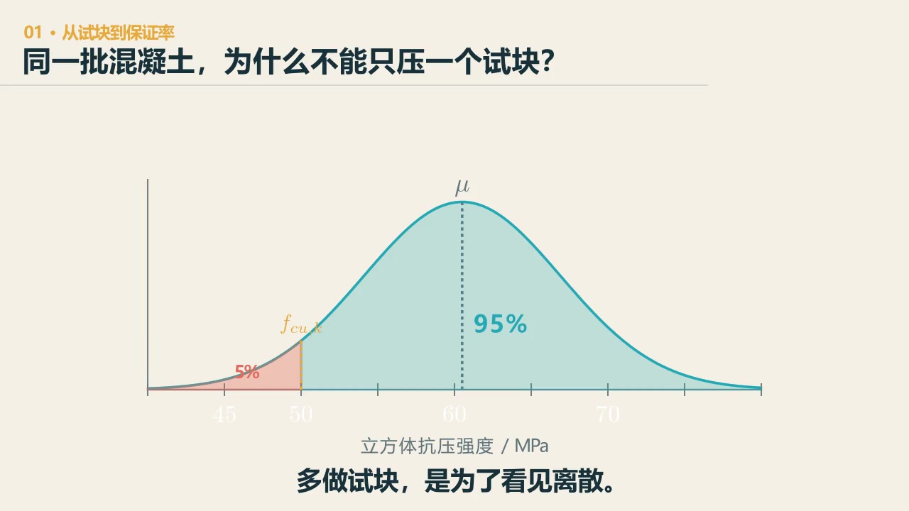
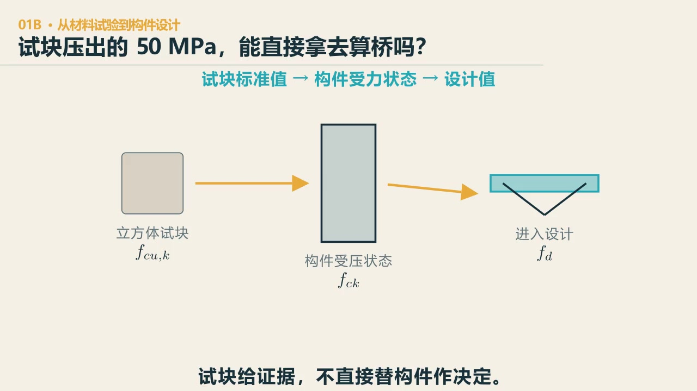
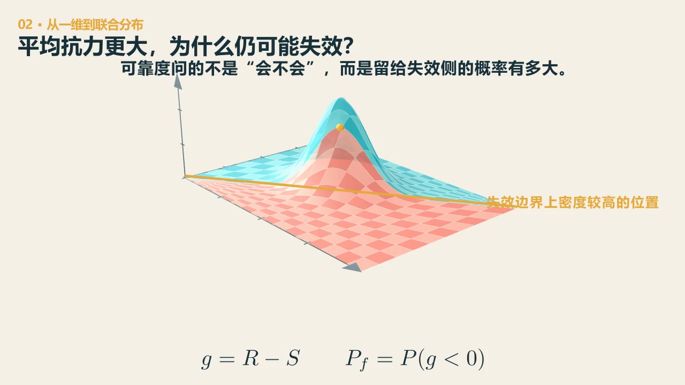

# 第 3 章　荷载：一座空桥，已经背了多少东西

::: {.chapter-question data-term="可靠度"}
赵州桥约重两千八百吨，课堂估计车辆约八到十吨。为什么不能说：它还剩两千七百多吨的承载力？
:::

桥是为了让交通通过。照这个目的看，桥的承载能力当然应该尽量留给车、人和列车。

可一座桥还没有上车，已经先背着自己。

## 两千八百吨的桥，能走多重的车

课堂上谈赵州桥，我没有先给结论。我把课堂里使用的一组估算放上去：这座桥自重约两千八百吨。然后让大家猜，它大约还能走多重的车。

有人往一千吨猜。我说，往极端一点猜。

课堂口述给出的数量级是八吨到十吨。这里先用它把“桥的自重”和“过桥车辆的重量”拉开；它不是拿两数相减得到的承载余量，也不是赵州桥今天的通行结论。历史评估载重、当代限载和设计承载力不是同一口径，不能用这组课堂估算互相替代。

教室里先是有点不太相信，随后慢慢反应过来。我当时借了一句电影里的话：为了这点儿醋，包了这么大一盘饺子——为了这十吨，包了一个两千八百吨的饺子。

这个比例很难忘。桥是为了让人和车过去的，可它首先得把自己举在那里。跨度越大，这件事越麻烦：你为了多跨一点，梁要加深、构件要加大；构件一重，新的自重又成了下一轮要承担的荷载。

赵州桥在天然地基上站了一千多年，这件事本身已经值得琢磨。我们当然可以继续追问沉降究竟有多少，但课堂里真正想留下的不是某个孤零零的数字，而是一个数量感：结构为了提供那条通道，先花掉了多少能力在维持自己。历史资料里的自重、评估载重和今天所说的车辆限载，也不是同一个口径，不能混成一个数。

## 先别背数字，动手看比例

下面这张“重量账本”沿用课堂里的估计，只用于建立数量感，不作为赵州桥今天的承载能力结论。先在心里猜一下比例，再揭晓；随后把桥的自重、车辆重量和车辆数改掉，看看什么条件下你的直觉会失效。

::: {.interactive-block}
<iframe src="../interactive/03-load-budget.html" title="空桥重量账本：自重与交通重量的参数化比较" height="590" loading="lazy"></iframe>

课堂数值不是赵州桥的正式承载鉴定数据；这里比较的是质量数量级，也不是设计承载力。若嵌入区域过窄，可<a href="../interactive/03-load-budget.html" target="_blank">单独打开工具</a>。

:::

## "空桥"其实不空

桥上没有车辆时，结构自重、桥面铺装、栏杆和附属设施已经存在。混凝土收缩徐变、预应力、温度和支座沉降也可能产生效应。车辆、风、船撞和地震，是在这些基础上继续进来的。

它们不能把各自的最大值简单相加。永久作用、可变作用、偶然作用和地震作用的持续时间、出现概率和组合方式都不同。课堂上讨论过：如果所有最不利的事情都在同一时刻发生，桥可能得按"碉堡"来设计——可我们付出的材料、造价和使用代价未必合理。设计一座桥，不是在设计一个堡垒。

作用为什么还要分类？结构自重每天都在，数值相对稳定；车辆的位置和数量不断变化；温度有日变化和季节变化；船撞、汽车撞击概率低，后果却可能很大；地震还有自己的频率内容和空间特征。它们怎样出现，决定了怎样组合、怎样取代表值。

课堂上还做过一个排列组合：三个支座都可能沉降，左边沉、右边沉、一起沉……一共七种。支座沉降常被归入永久作用，但究竟哪几个支座沉、沉多少，是有概率的。作用类别相同，不代表空间模式只有一个。

## 所有最大值，要不要一起加

先不查组合表。假定六项作用最后都换算成了同一个控制截面的弯矩：结构自重每天都在；车辆、风、温差和人群却各有自己的高峰。若把每一个峰值都安排在同一刻，结果会怎样？若只让一项作为这次的主角，其他作用按“它出现时通常会陪到什么程度”进入，结果又会怎样？

::: {.interactive-block .interactive-block--wide data-layout="flow"}
<iframe src="../interactive/03-load-combination-waterfall.html" title="荷载组合贡献与承载上限瀑布图" height="980" loading="lazy" sandbox="allow-scripts" data-layout="flow"></iframe>

每一根柱子都是同一控制截面的弯矩效应，最后一根才是合计。先在“所有峰值一起算”和“一项主导、其余伴随”之间切换，再改变主导作用；图中的系数和上限都是教学参数，不代替现行标准。若嵌入区域过窄，可<a href="../interactive/03-load-combination-waterfall.html" target="_blank">单独打开荷载组合账本</a>。

:::

看完图再记术语：永久作用先进入组合；一项可变作用成为主导作用，其余可变作用按组合值伴随。所谓**荷载组合**，不是凭感觉少算几项，而是把“哪些作用可能同时达到什么程度”写成可以检查的关系。真正设计时，组合形式、分项系数和组合值系数都应回到所采用的标准。

## 可靠不是"越大越好"

### 先看试块为什么不同

混凝土这种材料，离散性很大。同一批水泥、砂、石子和水，拌出来以后做成试块，养护到同一个龄期，一个个压下去，结果也不会整整齐齐落在同一个数上。材料有差别，拌和、运输、振捣和养护也有差别。所以试验时不能只压一块。只压一块，你得到的是这一块的脾气，不是这一批混凝土的把握。

### C50 不是“平均值为 50”

课堂上我问过：C50 是不是说试块的平均值为 50 MPa？不是。C50 里的 50，指按标准方法制作、养护并在规定龄期试验的 150 mm 立方体抗压强度**标准值**。所谓 95% 保证率，是说总体中至少有 95% 的强度不低于这个标准值。若暂时用正态分布理解，它落在平均值的左边。

95% 在曲线上怎样写

$$
P(f_{cu}\ge f_{cu,k})=0.95,
\qquad
f_{cu,k}=\mu_f-1.645\sigma_f
$$

这张图最容易混淆的地方是：95% 保证率说的是**材料强度标准值怎样从一批离散数据中取出来**，不是说整座桥有 5% 的概率会坏。

::: {.content-visible when-format="html"}

  <video controls preload="metadata" data-poster="../assets/videos/manim/01-concrete-guarantee-rate.jpg">
    <source src="../assets/videos/manim/01-concrete-guarantee-rate.mp4" type="video/mp4">
  </video>
  
18 秒看完：试块为何要做很多个，95% 保证率落在图的哪里。动画只讲变量关系，具体设计值仍应查采用的标准。

  
<a href="../assets/code/manim/bridge_math_basics.py" download>下载动画源码</a><a href="../assets/code/manim/scenes.md" download>下载分镜说明</a>

:::

::: {.content-visible when-format="epub"}

:::

### 试块值还不能直接拿去算桥

立方体试块的强度标准值，还要结合构件的受力状态，换到轴心抗压强度的标准值，再按所采用的标准得到设计值。这里先记住这条路，不背某个版本的表格数值。

先猜一下：都写着 50 MPa，试块强度标准值和构件设计值，哪一个能直接放进构件的设计表达式？为什么不能只挑大的那个？

看一眼“标准值到设计值”的抽象关系

$$
f_d=\frac{f_k}{\gamma_M}
$$

这个式子只说明设计值还要接住材料和模型中的不确定性，不代替现行标准的具体换算与取值。

::: {.content-visible when-format="html"}

  <video controls preload="metadata" data-poster="../assets/videos/manim/01b-concrete-to-design-value.jpg">
    <source src="../assets/videos/manim/01b-concrete-to-design-value.mp4" type="video/mp4">
  </video>
  
先把三件事分开：试块测得的是样本，标准值描述一批材料，设计值才进入具体设计表达式。短片只画关系，不替代规范取值。

  
<a href="../assets/code/manim/bridge_math_basics.py" download>下载动画源码</a><a href="../assets/code/manim/scenes.md" download>下载分镜说明</a><a href="../assets/code/manim/README.md" download>下载运行说明</a>

:::

::: {.content-visible when-format="epub"}

:::

### 荷载也会散开

每天什么时候车多，车有多重，车在桥上怎么排，都会变。抗力有自己的中心和离散程度，荷载也有。曲线下面积是 1；曲线越宽，只说明离散程度越大。

真正不利的情形，不只是“荷载有时大”或者“混凝土有时弱”，而是荷载恰好向大的数值漂，抗力又恰好向小的方向偏，两个在同一次事件里赶到一块。

我在课上拿赶约会打过比方：你们说十二点到，那肯定得十一点四十到，因为路上可能会堵。提前到有余量，确实能抵抗不确定性；可如果提前一天到，可靠度很高，未必合理。余量有成本。

还有个学生的回答我印象很深：一座桥被车压垮之后，司机辩解说，我没超载，因为我过别的桥都好好的。课上我们讨论过这句话——超载不一定立刻垮，但可靠度下降了，它不再是百分之百不会出事。可靠度不是"会不会坏"的开关，是概率和后果的账。

下面先不背可靠指标，也不急着谈规范取值。$R$ 表示这一次桥能提供的抗力，$S$ 表示这一次荷载造成的需求。每一次都是一对 $R,S$。把这一对数画成平面上的一个点，$R=S$ 就成为两侧的分界：$R\ge S$，这一次承受得住；$R<S$，这一次落到失效侧。

把“是否越过分界”写成式子

$$
g(R,S)=R-S,
\qquad
P_f=P\bigl[g(R,S)<0\bigr]
$$

::: {.content-visible when-format="html"}

  <video controls preload="metadata" data-poster="../assets/videos/manim/02-reliability-one-to-joint.jpg">
    <source src="../assets/videos/manim/02-reliability-one-to-joint.mp4" type="video/mp4">
  </video>
  
19 秒看完：两条边缘分布怎样变成同一次事件的联合分布，以及失效侧究竟在哪里。

  
<a href="../assets/code/manim/bridge_math_basics.py" download>下载动画源码</a><a href="../assets/code/manim/scenes.md" download>下载分镜说明</a>

:::

::: {.content-visible when-format="epub"}

:::

::: {.interactive-block .interactive-block--wide data-layout="flow"}
<iframe src="../interactive/03-resistance-load-reliability-lab.html" title="抗力与荷载波动、理论失效概率和有限样本不确定性实验" height="1680" loading="lazy" sandbox="allow-scripts" data-layout="flow"></iframe>

先看两条曲线怎样落成同一次事件的点，再看抗力与荷载各自的一维概率密度、联合概率密度地形、俯视等高线与蒙特卡洛散点，最后压缩成 Z=R−S 的一维分布。三维地形可以拖动旋转、滚轮缩放；转到不同方向，看看 R＜S 的失效侧究竟只是多薄的一片尾部。初始情形取二者相互独立；理论结果与固定随机种子的有限样本分开显示。它用于理解趋势与概率边界，不替代规范验算或真实桥梁可靠度分析。若嵌入区域过窄，可<a href="../interactive/03-resistance-load-reliability-lab.html" target="_blank">单独打开实验</a>。

:::

余量有成本：一句玩笑、战时桥和一部电影

工程圈里流传着一句出处不太说得清的玩笑：

> Any idiot can build a bridge that stands, but it takes an engineer to build a bridge that barely stands.

直译过来有点损：谁都能造一座站得住的桥，工程师的本事，是造一座“刚好站得住”的桥。

我喜欢这句话，但“刚好”二字要说清楚。它不是让桥摇摇欲坠，更不是取消安全系数。它说的是：在约定的荷载、寿命、环境、施工偏差和后果之下，余量应当够用，而且我们知道它大约在哪里。余量太小，风险失控；余量大得漫无边际，材料、造价和环境代价也失控。两边都不是设计。

把话再说狠一点：如果一座桥能顶住你能想象的任何超载，也未必值得夸奖。工程上本来就不存在“任何超载”这种边界。它可能只说明设计者没有把要求问清楚，不知道桥究竟要完成什么任务，于是只能不断加材料，让桥替自己的不确定买单。真正困难的不是把强度一直往上堆，而是能说明：为什么余量留在这里，为什么不是更多，也为什么不能更少。

战争里的临时桥，会把这组矛盾推得很近。材料从哪里来，多久必须抢通，准备使用多少天，被破坏以后能不能迅速更换，这些都会改变最合适的余量。有些任务会接受较短寿命、较少材料和更频繁的检查；有些后果太严重，反而需要更多冗余。战时桥并不是“可以不安全”，而是任务、时间、可修复性和失败后果都换了，可靠度与造价、效率的账也跟着换了。

《桂河大桥》可以当作一个电影里的思想实验来看，而不必把它当工程史。故事里的建桥并不是等所有问题都完全弄清楚以后才开始，而是在建造、观察和修复中逐渐收敛。现实工程当然不能靠倒塌来试错，但这个叙事提醒我们：工程从来不是全知以后才行动。重要的是试错能不能放在模型、样件和可替换构件上，能不能尽早暴露问题，失败的后果有没有被关在可承受的范围内。

结构设计竞赛里，这件事更直接。假设题目要求承重十千克，一个学生把模型做得很重，然后真的站上去，说：“老师你看，我这么重都没事。”这首先说明他根本不是按照十千克的要求设计的——实际教学中也不该这样拿身体去试。他没有把十千克变成杆件的内力、截面的尺寸和节点的做法，也不知道改细哪根构件会少承多少、加强哪个部位又能多承多少。最后只是先做出一个很重的东西，再看看它会不会坏。十千克这个要求，从头到尾没有真正进入他的设计。

竞赛常用承载力与结构自重之比衡量效率：

$$
\eta=\frac{P_u}{m_s g}
$$

但这也不是唯一答案。挠度、稳定、重复加载、节点损伤和制作误差，都会限制这个比值。真正有意思的是：桥刚好达到要求，同时还能说清余量受哪些不确定性控制。不是偶然扛住一次，而是对“差一点会怎样”心里有数。

一想到几千米、几百亿元的桥，就是从几条简单的力学关系和一组明确写下来的假设出发，一段一段悬出去，最后在江海上合龙，确实有一种了不起的浪漫。浪漫不在于公式永远不会错，而在于工程师知道公式删掉了什么，仍敢用试验、监测和一层层校核把不确定性接住。

## 先查重力对不对

我做结构模型时，第一件常查的事很简单：重力对不对。

假如模型里的材料与外加荷载质量合计一百吨，对应的重力约为 981 kN；在静止、没有其他竖向作用且结构未翘起的简化情形下，竖向支座反力总和也应回到约 981 kN。差得多，先查单位、自重开关、连接和边界，不要急着看彩色云图。这个检查很朴素，却能拦住不少错误——结构分析软件可以把结果画得很漂亮，但平衡关系不会因为图漂亮而改变。

## 把车推过去，看重量怎样落地

下面不是赵州桥模型，而是一座故意简化的虚构简支梁桥。你可以旋转视角、改变跨径与桥面尺寸，也可以把车辆从左端推到右端。观察总竖向反力始终等于桥面自重与车辆重力之和，但左右两端怎样分配，会随着车辆位置改变。

::: {.interactive-block .interactive-block--wide data-layout="flow"}
<iframe src="../interactive/03-reaction-bridge-3d.html" title="简支梁桥自重、车辆位置与支座反力三维模型" height="1180" loading="lazy" sandbox="allow-scripts" data-layout="flow"></iframe>

模型采用线弹性静力平衡，只把桥面板自重和单个车辆视为竖向荷载；未计主梁、横梁、动力冲击、横向分配及实际荷载组合。<a href="../interactive/03-reaction-bridge-3d.html" target="_blank">全屏打开三维模型</a>。

:::

## 承载效率不是唯一目标

自重占比高，不等于所有"非交通重量"都是浪费。更厚的保护层、合理的冗余、检修通道、防撞设施和耐久构造，都可能增加重量，却在保护另一项重要目标。所以承载效率要和安全、耐久、舒适、施工与维护一起看。不能一见"自耗"就删，还要问：这份重量在解决什么问题？如果拿掉，谁来接手？

::: {.chapter-method}
**数字要相减，先确认它们是不是同一种账。** 再往前一步：平均够用，不等于每一次都够用。材料质量、网络流量、医疗风险都要看分布、尾部和留出的余量。
:::

### 留给自己的一个动作

给一座你熟悉的桥画一个一百格的"承载预算"。先凭直觉分成结构自重、附属恒载、交通和其他作用四类，再查资料修正。不要只记最后比例，写下哪一项最出乎你的预料。

---
