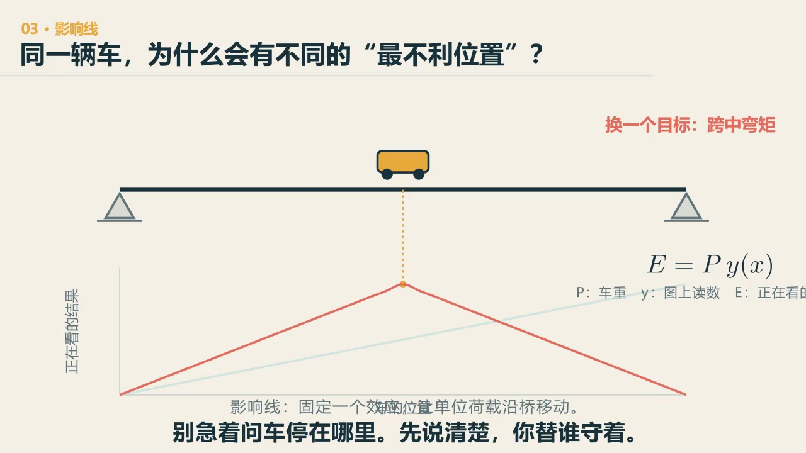

# 第 4 章　分配：车停在哪里，取决于你在看什么

::: {.chapter-question data-term="影响线"}
同一辆车，停在哪儿会让右边支座最累？停在哪儿会让跨中最难受？会是同一个地方吗？
:::

一辆车过桥，哪里最危险？

如果只看简支梁跨中弯矩，车停在跨中最不利——这个答案很熟悉。可把观察点换成支点反力，或者换成连续梁支点上方的负弯矩，最不利位置就变了。课上我们做过这样的选择题：车在哪个位置，右侧支座受力最大？在哪个位置，跨中弯矩最大？答案是两个不同的位置。

因此，“车在哪里最不利”这句话还没有问完整。必须先说明观察的是哪个截面、哪一种响应。

::: {.content-visible when-format="html"}

  <video controls preload="metadata" data-poster="../assets/videos/manim/03-influence-line.jpg">
    <source src="../assets/videos/manim/03-influence-line.mp4" type="video/mp4">
  </video>
  
20 秒看完：同一辆车，观察右支座反力和跨中弯矩时，为什么会得到两条不同的影响线。

  
<a href="../assets/code/manim/bridge_math_basics.py" download>下载动画源码</a><a href="../assets/code/manim/scenes.md" download>下载分镜说明</a>

:::

::: {.content-visible when-format="epub"}

:::

## 先只看一辆车

先问两个很具体的问题：同一辆车，要让右支座反力最大，应当停在哪里？要让蓝旗所在截面的弯矩最大，还停在同一个位置吗？

在下面的图里先选观察量，再移动车辆。蓝旗也可以移动。找到一个最大值以后，换一个观察量再做一次。

::: {.interactive-block}
<iframe src="../interactive/04-where-to-park.html" title="拖动车辆寻找不同观察位置的最不利停车点" height="760" loading="lazy"></iframe>

这里采用线性简支梁静力模型。拖动快慢不参与计算；若嵌入区域过窄，可<a href="../interactive/04-where-to-park.html" target="_blank">单独打开工具</a>。

:::

车还是那辆车，变的是我们所问的问题。看右支座反力，车越靠右，右支座分到的力越多；看某一截面的弯矩，峰值又会回到这个截面附近。说“车停在哪里最危险”还不够，至少要补上后半句：对哪个位置、哪个响应最危险。

## 把内力图反过来看

结构力学里讲过影响线。课堂上我先让大家回忆三个字，然后问：它到底在做什么？

普通内力图是荷载位置给定，沿结构看不同位置的响应；影响线则把观察位置固定，让一个单位荷载沿桥移动，记录这个观察量怎么变。

对某个响应 \(R\)，单位荷载位于 \(x\) 时，影响线纵坐标记为 \(\eta_R(x)\)。单个集中力 \(P\) 在 \(x_i\) 处时，

$$
R=P\,\eta_R(x_i),
$$

多辆车把各项叠加；均布荷载放到影响线同号、对目标响应有利的区段。

这个式子不复杂，困难在于先说清楚 \(R\) 是什么。看跨中正弯矩、支点负弯矩和某个支座反力，会得到三条不同的影响线。

## 全桥塞满车，不一定最坏

连续梁的影响线有正有负。为了让某个正弯矩最大，并不是所有跨都铺满荷载——负号区的车辆可能反而减小这个响应。课上给过三道车队题：车队一、车队二、车队三，怎么布置才能让某个弯矩最不利？答案要先分清符号：若要让负弯矩的绝对值最大，就压在负号区；若要让正弯矩最大，就压在正号区。不一定是满布荷载时最不利，这个结论当时大家觉得挺有意思。

下面把一跨简支梁换成两跨连续梁。先按自己的判断逐段放车，再试“全桥放满”“只放左跨”和“只放右跨”。观察量可以换成左跨跨中弯矩，也可以换成中支点弯矩。三辆车模式下，三辆车的位置可以分别调整。

::: {.interactive-block}
<iframe src="../interactive/04-continuous-loading.html" title="简支梁与连续梁的多车纵向布载" height="790" loading="lazy"></iframe>

色块代表沿桥长方向布置的等强度区段荷载，三车模式代表三个集中力。模型采用 40 个线弹性 Euler–Bernoulli 梁单元；可<a href="../interactive/04-continuous-loading.html" target="_blank">单独打开工具</a>。

:::

一跨简支梁的跨中弯矩影响线不变号，桥面放满同样强度的荷载，结果确实最大。连续梁不是这样。为了让左跨跨中正弯矩最大，右跨上一部分车辆可能起抵消作用；为了让中支点负弯矩最不利，也就是数值最小、绝对值最大，又要换一套布置。工程上把这件事说成：均布荷载布在与目标效应同号的区段，集中荷载放在有利的峰值附近。

这里还要分清一件事：**连续梁并不等于非线性。**只要材料、刚度和几何关系在所讨论的范围内没有随荷载明显改变，连续梁仍然可以用线性叠加和影响线。它只是超静定，不是因为支点多了便自动变成非线性。

桥越长、车道越多，所有位置同时出现最不利重车的概率也会变化。规范用车道荷载、集中荷载、横向分布、折减和组合，把这种不确定性转成可以计算的荷载模型。具体数值应回到所采用的现行规范核对，这里先抓住布载的道理。

但模型的假设可能被现实改变。有次我从家往楼下拍，桥头有个信号灯——早高峰，车在桥上堵死了。我当时看着就揪心：正常桥是让车通过的，信号灯却给车流加了一个周期，让一队车长时间停在桥面上。这个现象不能证明规范里的折减一概失效，却会迫使我们重新检查：原来假定的流动车流变成驻留车流以后，车辆强度、车距、停留时间和多车同时出现的模型还合不合适。一个交通组织措施，会改变结构实际看到的荷载分布。桥梁工程不能只在结构图里看桥，车怎样运行、在哪里停车，本来就是荷载模型的一部分。

## 沿桥长摆完，还要看横桥向

前面说的是纵向位置。实际车辆还有车道位置：同一个里程，车靠桥中还是靠外侧，对每片主梁并不一样。

先看一个最简单的横断面。两片主梁等刚度，中间由刚性横向构件连在一起。车辆从中间移向右侧，右主梁会多分一些，左主梁会少分一些。具体分多少，只需用竖向力平衡和力矩平衡就能得到。

::: {.interactive-block}
<iframe src="../interactive/04-transverse-share.html" title="车辆横向位置与两片主梁分担比例" height="720" loading="lazy"></iframe>

这是两片等刚度主梁的刚性横梁杠杆模型，只用来说明横向位置如何改变荷载份额。多梁桥、箱梁桥的实际横向分布还与桥面板、横隔梁和扭转刚度有关；可<a href="../interactive/04-transverse-share.html" target="_blank">单独打开工具</a>。

:::

工程上常把纵向和横向分开看：先由影响线判断车辆沿桥长应该放在哪一段，再由横向分布判断这一车道的荷载怎样分到各片梁上。两步都在回答同一个问题——一辆车的重量，最后由谁分担、分到多少。

这个两梁杠杆模型只是起点。多片梁通过桥面板和横隔梁共同工作；箱梁还有很明显的扭转；车辆靠近边缘时，边梁及悬臂板的受力也会变化。到这一步，规范的横向分布系数、梁格模型、板壳模型各有自己的适用范围，不能把上面的百分比直接拿去设计。

## 拱桥和索承桥，哪里会不一样

影响线并不是梁桥专用。只要先确定一个线性结构模型，拱桥、斜拉桥和悬索桥也能计算某个响应的影响线。问题在于：移动荷载是否会明显改变结构本身的工作状态。

先做一个不带术语的检验。把两辆车分别加载所得的结果相加，能不能得到两辆车同时上桥的结果？把荷载加倍，位移和内力是不是也刚好加倍？如果在所研究的范围内基本成立，我们就可以继续使用线性叠加；如果不成立，原来那张固定的“停车地图”便不够了。

拱桥承受竖向荷载时，不只有弯矩，还有轴向压力和水平推力。不对称荷载往往会增大弯曲，使拱轴偏离压力线；对于细长受压拱，几何变形、初始缺陷和失稳还可能相互放大。因此，拱桥当然可以先做线性分析，但涉及大位移、稳定、开裂或屈服时，需要进入几何或材料非线性分析。

斜拉桥先要在恒载下找到合理的成桥线形和索力。边跨单独加载、主跨偏载时，索塔两侧不再平衡，塔、梁和斜拉索会一起重新分配内力。索的垂度效应，以及塔、梁在较大轴力下的梁柱效应，是常见的几何非线性来源。

悬索桥更明显。主缆的张力本身就在给桥提供刚度，活载又会改变缆形和索力。恒载占主导、活载引起的索力变化很小时，可以在恒载平衡状态附近线性化；超出这个范围，就需要对不同布载重新求非线性平衡。边跨加载和主跨不对称加载之所以值得单独看，不只是“车在哪儿”，还因为整个受力形状可能跟着变。

关于这些边界，可以继续参看 FHWA《[Manual for Refined Analysis in Bridge Design and Evaluation](https://www.fhwa.dot.gov/bridge/pubs/hif18046.pdf)》对斜拉桥、悬索桥几何非线性的说明，以及论文《[Structural integrity of tied arch bridges affected by instability phenomena](https://www.sciencedirect.com/science/article/pii/S2452321619304500)》对拱桥初始状态、几何非线性和屈曲的讨论。

## 这套问法也不只用在桥上

影响线背后有一个很朴素的思维方法：先固定你关心的结果，再让输入沿着可能的位置移动，画出“输入放在哪里，结果会怎样变”的地图。

仓库选址可以问某个站点放在哪里最省总运输距离；医院急救资源可以问放在哪里能把最迟到达时间压下来；软件系统排查性能问题，也可以固定一个响应时间，把请求量逐个移到不同模块，看哪个位置最敏感。它们的公式并不相同，但问法相通：**先把结果说清楚，再谈哪里最不利；先看局部敏感性，再决定资源放在哪里。**

::: {.chapter-method}
**先说清自己究竟在守哪个结果，再去找最坏位置。** 仓库选址、急救站布置、软件性能优化都会遇到同一件事：要守延迟、成本还是尾部风险，最坏答案并不相同。
:::

## 留住第一次判断

如果有一个可以拖动的车辆模型，不要一打开就让软件标出答案。先选观察量，自己把车停一次，再看曲线。

判断错并不浪费。第一次选择和影响线给出的第二次选择之间的差，正好说明你原先把什么当成了固定事实。

### 留给自己的三个动作

1. 在连续梁工具里，先不点“显示最不利区段”，分别为左跨跨中正弯矩最大和中支点负弯矩绝对值最大摆一次车。截一张自己的第一次判断，再同计算结果比较：你多放了哪一段，少放了哪一段？
2. 在横向分布工具里把车辆移到最右侧。在不看百分比的情况下，先按重要性给三件事排序：右主梁弯矩、左主梁弯矩、桥面横向弯曲。然后写一句话说明，为什么“离车远”不等于“完全没有作用”。
3. 任选拱桥、斜拉桥或悬索桥，提出一个可能使线性叠加失效的加载情形。不要只写“有非线性”，要指出究竟是什么变了：形状、索力、轴力刚度，还是材料状态。

