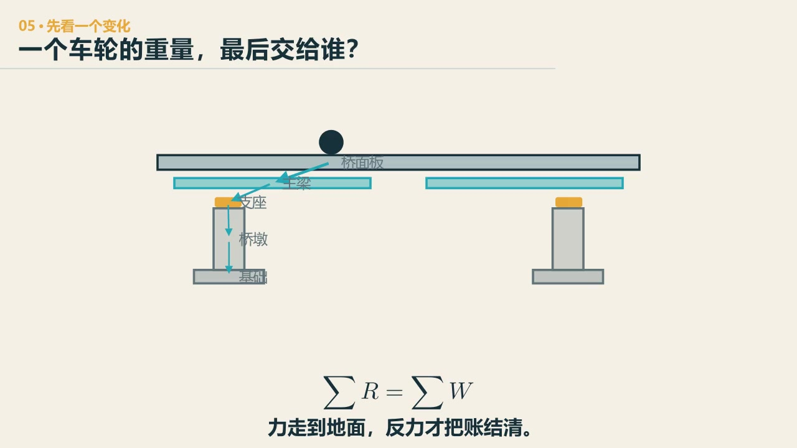

# 第 5 章　力路：一辆车的重量，最后交给了谁

::: {.chapter-question data-term="传力路径"}
一只车轮压下去，最后到底是谁在手里接着——桥面、主梁、桥墩，还是脚下那层土？
:::

看一座桥，我们很容易先看见塔、拱和拉索。它们大，也有特点。可要判断这座桥是不是真的按我们想的方式工作，我更愿意从一只车轮开始。

车轮压在桥面上，力先到桥面板，再由桥面板交给主梁和横梁，主梁把它送到支座，支座送到桥墩和桥台，最后由基础交给地基。不同桥型中间会走不同的路，但这条路最后要闭合。

建筑结构里也一样。课堂上讲过：重物荷载作用在板上，板把它传给主梁和次梁，再传到柱网。名称不同，基本问题没有变——这份重量现在由谁接着？

先问：车轮压在桥面上以后，下一步会由哪个部件接住这份重量？

::: {.content-visible when-format="html"}

  <video controls preload="metadata" data-poster="../assets/videos/manim/05-force-path.jpg">
    <source src="../assets/videos/manim/05-force-path.mp4" type="video/mp4">
  </video>
  
<a href="../assets/code/manim/bridge_mechanics_series.py" download>下载动画源码</a><a href="../assets/code/manim/mechanics_scenes.md" download>下载分镜说明</a><a href="../assets/code/manim/README.md" download>下载运行说明</a>

:::

::: {.content-visible when-format="epub"}

:::

::: {.interactive-block}
<iframe src="../interactive/fundamentals-lab.html?mode=forcepath" title="梁桥、拱桥与斜拉桥传力路径" height="710" loading="lazy"></iframe>

先用短片把这一路交接看清，再换桥型、拿掉一个连接，看看重量是否还能到达地面。线宽不表示真实内力；<a href="../interactive/fundamentals-lab.html?mode=forcepath" target="_blank">单独打开实验台</a>。

:::

这条逐级交接的路线叫**传力路径**；动画只示意一个完整、静止的主要路径，真实桥梁还会因连接、裂缝、施工状态或支座变化而重新分配荷载。

## 同一份力，在几门课里换了几次名字

理论力学把一件东西单独拿出来，问它受哪些力、能不能平衡。到了结构力学，我们不再只看一个物体，而是看板、梁、柱、索和支座怎样连成体系，外力经过体系以后，各构件得到多少轴力、剪力和弯矩。材料力学把镜头再推近一些：这一根构件有了内力，截面上的应力怎样分布，会不会变形得太大。结构设计原理继续往下走，把内力变成截面尺寸、钢筋、连接和构造。桥梁工程只是把这条链放回河流、道路、施工和运营里。

所以这些课不是几摞各自结课的公式。桥面板把轮载交给横梁，这是结构体系的问题；横梁里哪一边受拉，是材料力学的问题；混凝土裂了以后由谁接力，是结构设计原理的问题；横梁能不能运到现场、吊装时又由谁托住，才到了桥梁工程的真实条件。沿着一份重量追下去，几门课自然会接起来。

我更希望学生养成这样的顺序：先把对象拿出来，再看它怎样平衡；先看体系给了它什么内力，再看材料怎样承受；最后才讨论截面和构造。顺序一乱，就很容易看见一张配筋图，却说不清这根钢筋为什么在这里。

## 画在一起，不等于连在一起

学生做三维模型时，常出现一个很有欺骗性的情况：两个构件在屏幕上看起来已经碰到一起，旋转起来也很像一座完整的桥，可进入计算以后，力就是传不过去。

课堂上我们遇到过很具体的事故现场：节点没有连上、约束给得不对，模型一算，塔整个飞出去了。节点是不是共用的？连接允许传轴力、剪力和弯矩中的哪些？构件端部有没有释放？这些信息在效果图里看不见。几何上挨在一起，不等于力学上连在一起。

所以检查模型时，可以先做一个很朴素的动作：把某个连接断开，或者干脆删掉一根杆。课上我们在游戏里反复做这件事——删掉一根、增加一根，看哪根是最不可缺少的。若删掉以后外形几乎没变、力路却突然换了，说明这根确实在工作；若删了以后什么都没变，它可能只是一件装饰。

## 先定性，再看云图

我希望学生打开结果之前，先对结果有个预期。课上说过：对结果的趋势有没有一个定性的认识，对结果的量有没有一个预期——这比看软件颜色更重要。计算的目的不是数字，是洞察。

算完以后再比较：反力在哪里，受拉、受压和受弯的构件是不是大致在预期位置。如果不一致，先不要说"软件算错了"——检查单位、荷载、支座、连接和刚度。模型有时会给出一个完全合乎它自身设定、但不是我们想算的答案。

另外，传力路径不是一条永远不变的红线。构件开裂、屈服、支座失效或施工体系转换后，荷载会重新分配。我们画的第一条路，只是某个状态下的主要路径。

## 反力是路径落地的收据

画力路最容易画到桥墩就停。其实桥墩还要把力交给承台、桩或扩大基础，再由土体承担。软弱地基、冲刷或不均匀沉降，会反过来改变上部结构看到的边界。

洪水冲刷尤其容易被看成桥外面的事。水把桥墩周围的土带走，少掉的不只是一圈土，也可能是基础的有效埋深和侧向约束。对上部结构来说，相当于原来画得很牢的支点悄悄松了、长了，甚至挪了位置。这时把主梁网格再细一倍，也补不回一个判断错了的地层和基础。

因此，力路图最后不能只画一条代表地面的粗线。地质勘察告诉我们力交给了什么土层，桩基施工记录说明它是否真的到了那里，洪水后的冲刷检查则要确认这条路今天还在不在。上部结构算得很细当然有价值，但它必须站在一条真实存在的力路上。

支座反力像这条路径在接口处留下的收据。各支座反力的和应与总荷载平衡，分配又应与跨度、刚度和支承位置相符。一座对称桥在对称荷载下，一侧几乎没有反力——先查有没有漏接；一座外形很像悬索桥的桥，主梁却承担了全部弯矩——先查索是不是真的在参与，是不是只是装饰。

::: {.chapter-method}
**沿着一样东西的去向，一段一段追到它的出口。** 力、能量、水、现金和信息都不会在“反正过去了”里凭空消失；每一个接口都要说清谁接手。
:::

### 留给自己的一个动作

找一张斜拉桥、拱桥或悬索桥的侧视图。不要先写桥型名称，只从一辆车开始，连续画到地基。每经过一个接口，写出这个接口至少要传递哪一种力。若中间有一步只能写"应该是传过去了"，把它圈出来。

---
