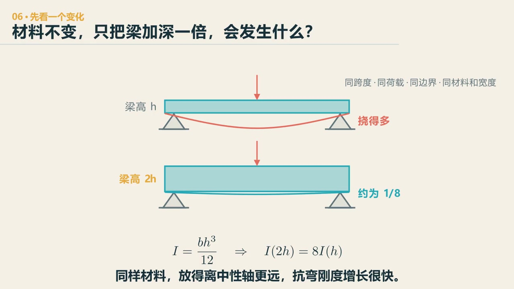
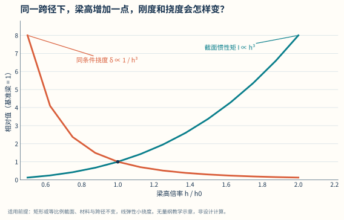

# 第 6 章　受弯：一根梁怎样跨得更远

::: {.chapter-question data-term="抗弯刚度"}
材料不换，只把梁做高一倍，车一上去，它为什么会“硬气”这么多？
:::

跨度一大，弯矩按 \(qL^2\) 涨，自重跟着涨。书上的截面、体系、材料，几乎都是在回答同一个问题：这根梁跨不过去了，怎么办。课堂上一开始说过，我们要从跨度增长的过程中看到桥的演化，而不是先看见一长串截面形式和材料名称。

先问：材料不变，只把梁加深一倍，它会弯下去得更多还是更少？

::: {.content-visible when-format="html"}

  <video controls preload="metadata" data-poster="../assets/videos/manim/06-beam-depth.jpg">
    <source src="../assets/videos/manim/06-beam-depth.mp4" type="video/mp4">
  </video>
  
<a href="../assets/code/manim/bridge_mechanics_series.py" download>下载动画源码</a><a href="../assets/code/manim/mechanics_scenes.md" download>下载分镜说明</a><a href="../assets/code/manim/README.md" download>下载运行说明</a>

:::

::: {.content-visible when-format="epub"}

:::

::: {.interactive-block}
<iframe src="../interactive/bridge-systems-atlas.html?mode=beam" title="梁高、跨度、变形与空间弯矩图三维模型" height="760" loading="lazy"></iframe>

先看梁怎样弯，再调梁高与跨度。弯矩图悬置在主梁同一纵向坐标上；图高为固定归一化显示。主梁变形按挠跨比趋势 δ/L∝L³/h³ 放大，只比较比例，不表示绝对挠度。<a href="../interactive/bridge-systems-atlas.html?mode=beam" target="_blank">全屏打开三维模型</a>。

:::

<figure class="data-figure">

<figcaption>在跨度、宽度、材料和荷载不变的理想比较中，梁高通过三次方影响弯曲刚度。</figcaption>

<a href="../assets/data-figures/02-depth-stiffness-deflection.csv" download>下载图中数据 CSV</a><a href="../assets/code/data-figures/generate_data_figures.py" download>下载绘图代码</a>

</figure>

截面抵抗弯曲的量叫**惯性矩**：矩形梁有 \(I=bh^3/12\)，在宽度、跨度、材料和荷载不变的理想比较中，梁高加倍，挠度约变为原来的 \(1/8\)；实际梁还要检查自重、剪力和稳定。

## 加高之前，先看材料用在了哪里

最直接的办法是把梁做高。矩形截面的抗弯截面模量

$$
W=\frac{bh^2}{6},
$$

梁高 \(h\) 以平方进入，比单纯增加宽度更有效。可整块实心加高，自重也跟着增加——高度增加，自重只多一次方，截面模量多两次方，有点像"以毒攻毒"：自重也增大了，只是能力增大得更快。

然后看弯曲应力在截面上怎么分布：上、下缘大，中性轴附近小。学生在结构设计原理课里提到减轻重量，我顺着说：哪块儿没用，就"该减减，该省省"——该上的课上，不该上的课，水课就不上了。把靠近中间的材料减掉，把材料更多留在上下缘，就长出工字形、T 形和箱形截面。

这不是说中间腹板没用。它还要把上下缘连在一起共同工作——平截面假定要求它们一起变形；中间全掏空，就变成两个独立的结构了。它还传剪力、面对局部稳定和施工。只看弯曲应力删材料，很快会删过头。

课上还说过一句：这些截面不是互相取代的进化阶梯。跨度不同，设计的思路就不同——它们已经是不同的物种了。

## 一条弯曲关系，怎样穿过三门课

材料力学先告诉我们，梁弯起来以后，中性轴两边一侧受压、一侧受拉，离中性轴越远，应力通常越大。结构设计原理接着处理材料的脾气：混凝土受拉开裂以后，让钢筋接过拉力；再用变形协调、内力平衡和材料关系把截面重新合在一起。到了桥梁工程，同一套关系没有消失，只是梁变长了、截面变复杂了、体系也会让弯矩换号。

所以“钢筋放下边”只在特定位置成立。简支梁跨中是正弯矩，下缘受拉；连续梁支点和悬臂根部常出现负弯矩，受拉边转到上面。桥面板还可能同时沿纵、横两个方向工作。若只记住一张简支梁配筋图，换个部位，答案就跟着翻面了。

下面只给你一层钢筋。先把它放到简支梁跨中最有用的地方，再切换到连续梁支点或悬臂根部，不要改口号，只移动钢筋。

::: {.interactive-block}
<iframe src="../interactive/material-behavior-lab.html" title="梁体系、弯矩符号、截面形状与钢筋位置联动实验" height="910" loading="lazy"></iframe>

裂缝和应力区是帮助判断的示意，不代替配筋、裂缝、锚固、剪切或极限状态验算；<a href="../interactive/material-behavior-lab.html" target="_blank">单独打开材料行为实验</a>。

:::

这个动作很小，却把三门课接在了一起：先由体系和荷载得到弯矩，再由弯矩找到截面的拉压边，最后才轮到材料与构造。软件可以很快画出弯矩图和配筋结果；我们至少要能在图出来以前猜到哪一边在拉，图出来以后也能看出它有没有把上下弄反。

## 裂了以后，梁为什么还没有结束

在最初那一小段荷载里，钢筋和混凝土的应力、应变大致按弹性关系增长，接近材料力学里熟悉的胡克定律，画出来很整齐。可材料不一定永远弹性，钢筋混凝土梁真正有意思的地方，恰好从混凝土受拉开裂开始。裂缝出现以后，受拉混凝土能分担的力减小，钢筋接过更多拉力，中性轴和截面刚度也跟着变化。原来那条直线关系已经不够用了，但梁并没有因此立刻失去承载能力。

设计时希望受拉钢筋先进入明显变形，而不是让受压混凝土或剪切机制突然结束工作，原因也在这里：前一种破坏会给出变形和裂缝这些信号，后一种往往来得更快。所谓延性，不是“材料比较软”，而是结构越过最初的弹性阶段以后，还能通过材料接力和内力重分配保留一段可以察觉、可以应对的过程。

这也是线弹性模型的边界。它很适合回答初始刚度、内力趋势和小变形，却不能把一条直线一直外推到破坏。看到云图以后要再问一句：当前结构还在弹性段，还是已经开裂、屈服，力路也换了？

## 弯矩图之外，还有一张不能丢的图

梁跨中常是弯矩最大的地方，简支梁支点附近则是剪力较大的地方。两张图不是互不相干：没有集中力偶的区段里，(dM/dx=V)，剪力就是弯矩沿桥长改变的快慢；集中力会让剪力图跳一下。只盯跨中受弯，很容易把靠近支点的斜裂缝漏掉。

剪切可以先从三块叠起来的薄板理解。它们一起弯时，层与层之间会有相对错动的趋势；若没有胶、钉或别的界面传力，三块板就不会像一块同样厚的整体板那样工作。混凝土梁里的斜裂缝，也是拉压应力重新组合后的痕迹。箍筋和弯起钢筋跨过可能张开的裂缝，把两边重新拉在一起；混凝土、纵筋、箍筋和拱作用共同接力，而不是某一根钢筋独自“抗剪”。

桥梁还常遇到扭转。车辆偏在一侧、曲线桥、箱梁的偏心支承，都可能让截面既弯又扭。开口的工字形很会抗弯，闭合箱形通常更善于形成环流剪力、抵抗整体扭转。于是箱梁中间的材料并不是因为弯曲应力小就都能挖掉；材料放在哪里，要看它同时替我们做了几件事。

## 放在一起，还要能一起变形

钢梁上铺一层混凝土桥面板，看起来已经叠在一起了，力学上却未必是组合梁。弯曲时，钢梁和混凝土板想沿界面相对滑动；剪力连接件把这种错动限制住，才使两种材料共同形成更大的截面。这个道理和上一章的“画在一起不等于连在一起”是同一件事，只是现在把镜头放到了材料界面。

钢管混凝土又像把里外交换了一次：外面的钢管可以先充当轻便的施工骨架和模板，灌入混凝土以后，钢管约束核心混凝土，核心混凝土又支撑钢管、延缓薄壁钢管局部屈曲。钢与混凝土仍各有脾气，但摆放关系变了，彼此的短处也就换了一种补法。很多好构造不是又加了一种材料，而是让两种材料在正确的位置、通过可靠的界面一起工作。

## 加一个支点，问题会换地方

弯矩常带 \(qL^2\)。在中间增加支点，把一个大跨度分成两个小跨度，弯矩明显下降。这就是很强的一种"支援"。

代价也很具体。跨海的时候，桩基础很贵——一千米要五十个桥墩，桩的钱就不得了；一跨过去，下部结构的钱省下来，换成上部结构。还有通航：本来通航净高五米，现在要提高到六米，怎么办？我去实习时见过一个很疯狂的做法：不用拆桥，花几个亿，用大约一百个千斤顶同步把整座桥抬高一米，再往下垫起来。好处不是凭空来的，另一部分结构和现场条件接手了困难。

## 材料、预应力和体系

换强度更高或更轻的材料，改的是公式里的系数。预应力则不同——它不只是"更强的钢筋"。

课堂上做过一个演示：请三位同学上台，两位拉住一根有弹性的绳，中间一位把它锚固在结构上，然后慢慢松手。力就传到了结构上，给它一个预先的压力。混凝土受压很好，受拉很差，一拉就容易开裂；提前给它一个压力，它就先把这个压力吃掉，才轮到受拉。当时学生说出这个想法的时候，我说：太聪明了，你就想到这个了。

预应力混凝土这个概念，我认为在所有天才的榜单里能排前三。有个细节值得想：为什么在普通的非预应力钢筋混凝土里，高强钢筋的强度常常用不充分？钢筋的强度是靠变形换来的——它要发挥更高的应力，就得伸长更多；可与它共同变形的混凝土会先开裂，裂缝和挠度往往先把正常使用状态卡住。预应力先把钢束张拉起来、把混凝土压住，让高强钢的能力不必等到使用阶段出现很大的裂缝才发挥。

课上还提过我买的一张储物床。屋子不大，床板下面要放东西；可床垫有五十公斤左右，真让人每次硬抬，谁也不愿意用。床架里装了气弹簧。安装时床垫还没到，师傅特别提醒：没有床垫压着，床架会自己弹起来，别站在旁边。等五十公斤的床垫放上去，人手上需要补的力大约只剩五公斤，掀起和缓慢放下都容易得多。

这个例子和预应力不是同一个定量模型：储物床还用了气弹簧的预载、转动几何和杠杆关系。但它们有一层很值得借来的共同想法——使用荷载来以前，先安排一股方向有利的力。对预应力梁，这股力给混凝土带来预压和反向弯矩；铺装、栏杆和车辆再上来，原本上拱的梁才逐渐回到我们希望的状态。于是设计不能只看成桥，还要看床垫没放上去那一刻：预拱太大，上缘也可能先开裂。

对一根简支梁，若预应力合力为 \(P\)，对截面形心偏心距为 \(e\)，它带来的弯矩量级为

$$
M_p=P e.
$$

跨中正弯矩大，钢束布在下方更有利；连续梁支点负弯矩区，布束需求会换向。钢束线形为什么常随弯矩图变化，从这里就能理解。

钢束张拉时读到的力，并不会一成不变地留到几十年以后。锚具回缩、孔道摩擦和混凝土弹性压缩，会让一部分预应力较早损失；混凝土收缩、徐变和钢筋松弛，则把变化慢慢带进使用期。可以把有效预应力先写成一笔很朴素的账：

$$
P_{\mathrm{eff}}=P_0-\sum_i \Delta P_i.
$$

重要的不是先背六个名字，而是知道每一种损失从哪一种相对变形或材料时间效应来。钢束和孔道发生摩擦，远端得到的张拉力就会少；锚具往回缩一点，已经拉长的钢束会松一点；混凝土在持续压力下继续变短，和它共同变形的钢束也会丢掉一部分拉力。于是 \(M_p=Pe\) 里的 \(P\) 不是张拉当天的一个永久常数，而是会随施工方法、位置和时间变化的有效值。

这张损失清单是一种记账方式，不是说每个项目在每座桥上都同样出现。先张还是后张、分几批张拉、钢束有没有黏结、比较的是哪个施工阶段，都会改变该算哪一项、怎样互相影响。

这件事也说明，预应力不只是一个截面承载力问题。它把材料本构、施工顺序、锚固构造和长期使用接到了一起。计算软件可以逐项算出损失；学生更需要先判断：哪一项是立即发生的，哪一项会慢慢发生，改用先张法、后张法或改变束长后，哪一项会跟着明显改变。

## 游戏里的钱，帮我们看见取舍

Poly Bridge 里一座桥通车以后，会显示造价和构件利用程度。学生很快会做一件工程上很自然的事：把太富余的杆件调小，看看能不能省一点。

我会让大家继续调，但游戏的核心不是省钱，而是通过钱这个概念看清哪些东西是可以省的。游戏本身有它的限制——桥面一块一块全是直线，做不了弧线；材料只有那几种。它的用处是让修改立刻有反馈：梁高降一点，材料少了，利用程度提高；再降一点，变形或强度开始控制。

有人害怕失败，所有构件都做得很粗；有人只追最低价，把结构调到刚好通车一次。两个极端都不是设计。真实工程里，余量要能说清在防什么。

::: {.worked-example-link}
**把这一段落到一根真实的梁上：** [钢筋混凝土矩形梁抗弯案例](../appendices/rc-bending-worked-example.qmd)。先看截面里的拉、压怎样形成内力偶，再把计算需要的钢筋面积换成真实根数和直径；选完以后，还要回到平衡重新验算。
:::

## 为什么还要说"最简单"的那一句

课上说过：在适用范围内，最简单、最便宜的东西，反而适用范围最广。我的研究生师兄，哈工大毕业，学了各种高等桥梁、悬索斜拉大跨度，到设计院干了四五年，全在做梁桥——最简单的那种简支梁桥。这不是泼冷水。工程的大多数时间不在边界上，够用的时候，不需要为了显得先进把所有办法都装上去。

::: {.chapter-method}
**不要对所有变量平均用力，先找那个最有杠杆的。** 散热片的面积、流程里的瓶颈、算法里的增长阶数，都值得先做敏感性判断：改哪一个量，结果动得最快？
:::

### 留给自己的一个动作

在一根简支梁上只允许做一次修改：加高、挖空、换材料、增加支点、施加预应力、限载。任选一种，分别写"它首先改变了哪个量"和"它新带来的一项问题"。不要写"提高承载力"就结束。

---
