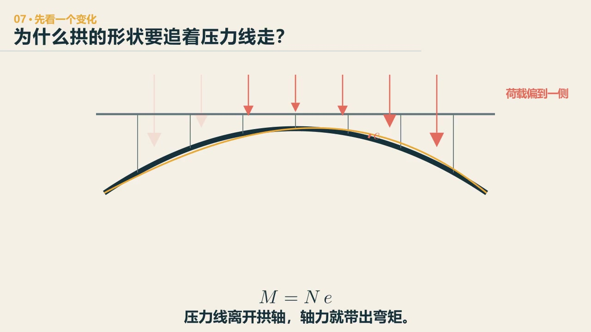
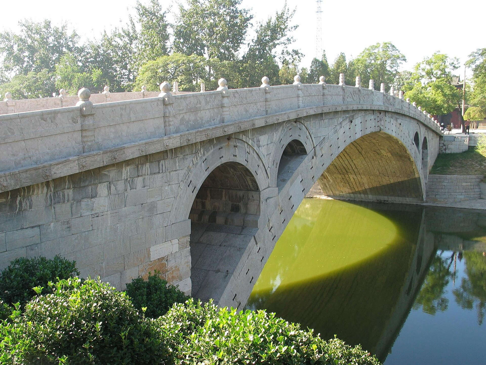

# 第 7 章　受压：有一条弧线，还不能叫拱

::: {.chapter-question data-term="压力线"}
车从拱顶挪到左边，拱的形状没变，弯矩为什么又回来了？
:::

学生在游戏里做过很多拱桥。屏幕上一排看过去，都有弧线，有些还很好看。我让大家互相判断：这些作品里，哪些其实不是拱桥？

这个问题不是挑外形的毛病。我们想看的是，那条弧线到底有没有承担主要荷载——看它的受力。有人把车直接放在拱上走，也有人把桥面做平、让拱在下面撑——课上我们讨论过"路面拱"和"结构拱"的区别：车是在拱上走，还是在平的桥面上走？真实拱桥里，一般还是以平的桥面为主，车在拱上爬陡坡，下雨下雪会很麻烦。还有学生说过一句很到位的：绳子只能拔河，不能推河——所以能用绳子的地方，说明那里只需要受拉。

桥不是只有"站得住"这一件事。人和车怎样使用它，也会改变构造。

先问：把荷载从中间挪到一边，拱里哪一处会先变得更吃力？

::: {.content-visible when-format="html"}

  <video controls preload="metadata" data-poster="../assets/videos/manim/07-arch-pressure-line.jpg">
    <source src="../assets/videos/manim/07-arch-pressure-line.mp4" type="video/mp4">
  </video>
  
<a href="../assets/code/manim/bridge_mechanics_series.py" download>下载动画源码</a><a href="../assets/code/manim/mechanics_scenes.md" download>下载分镜说明</a><a href="../assets/code/manim/README.md" download>下载运行说明</a>

:::

::: {.content-visible when-format="epub"}

:::

::: {.interactive-block}
<iframe src="../interactive/bridge-systems-atlas.html?mode=arch" title="拱高、偏载与弯矩变化三维入门模型" height="760" loading="lazy"></iframe>

先看压力线怎样偏开，再只动两个量：把拱压扁、把荷载挪到一侧。看看哪一种变化更快地把弯矩带回来；<a href="../interactive/bridge-systems-atlas.html?mode=arch" target="_blank">全屏打开入门模型</a>。

:::

荷载合力在拱内的走向叫**压力线**；它偏离拱轴的距离会带来弯矩 \(M=Ne\)，这里仅用于说明理想拱在对称与偏置荷载下的趋势，不能替代砌体、基础和空间效应的验算。

展开高级案例：轮载怎样从桥面板走进双肋主拱

<iframe src="../interactive/arch-bridge-hybrid-fem.html" title="桥面壳、纵横梁、拱上立柱与双肋主拱混合有限元模型" height="880" loading="lazy"></iframe>

这是从“20260721数字孪生”并入的壳—空间梁混合有限元。它适合在已经看懂“偏载会把弯矩带回来”以后，再追轮载怎样经桥面壳、纵横梁和拱上立柱进入双肋主拱与四个拱脚。<a href="../interactive/arch-bridge-hybrid-fem.html" target="_blank">全屏打开完整求解器</a>。

## 先从一首小调讲起

如果只从定义开始讲拱，实在有点可惜。赵州桥在很多人心里并不是从"圆弧敞肩石拱桥"开始的，而是从《小放牛》开始的：

"赵州桥是谁修的？玉石栏杆什么人留？什么人骑驴桥上走？什么人推车压了一道沟？"

民歌里的答案是鲁班、张果老和柴王爷。传说鲁班修完桥，夸它结实。张果老便把日月星辰装在驴背上，柴王爷把三山五岳装进车里，两个人偏要来试一试。驴蹄和车轮在桥面上压出印子，桥也被压得往下沉。最后还是鲁班跳到桥下，用手把它托住，才留下了桥腹的"手印"。

我们现在当然知道桥并不是这样建的，设计建造者是隋代匠师李春。但我很喜欢把这段传说留在课堂里。它把几个很工程的问题藏在了故事中：桥能承多少？试桥时谁先过去？桥面为什么留下痕迹？结构出现挠度以后，支撑该加在哪里？老百姓没有"静载试验""临时支撑"这些词，却把对承载、试验和抢险的理解编进了一头驴和一辆车里。

传说还认真替鲁班安排了施工。河里有水，玉皇大帝请蛟龙把河水吸干；没有材料，派了很多羊过来，鲁班把它们变成铺石；桥太宽太重，二十八星宿一人托起一道拱券，最后拼成一座桥。西方许多古拱桥被称作"恶魔桥"，也常有和恶魔订立契约、一夜建成、拿第一个过桥者灵魂的故事。两边的神话很不一样，背后的惊讶倒很相似：以当时普通人的眼光，这么大的石拱实在不像人能做出来。当时的人看到这桥不知道是怎么建的，只觉得只有神的力量才建得出来。

茅以升当年写赵州桥，也提了四个问题，我上课就顺着这四个问题讲：为什么是单孔而不是多孔？为什么石拱是扁弧形而不是半圆形？为什么用二十八道独立石拱拼成而不是一道大石拱？为什么拱的两肩要开小孔？这四个问题到今天仍然是最好的讲法。

::: {.real-bridge-figure}
{fig-alt="赵州桥侧向照片，主拱较坦，拱肩设有小拱"}

先别把它当风景照。沿主拱圈走一遍，再找四个肩上小拱和桥面坡度；随后问一句：这张照片能看见拱的纵向形状，却能不能看出桥宽方向的二十八道拱券？照片：Zhao 1974，公有领域；来源见图片说明。
:::

## 为什么费尽心思做成弧

我会接着问：为什么要把拱做成一个弧？

如果只是为了好看，直梁也可以做成弧形外轮廓。拱的意义在于：荷载与轴线配合时，构件主要以受压工作，水平推力帮助它抵抗弯矩。

对一个简化三铰拱，可以把梁在同一荷载下的弯矩 \(M_0(x)\) 和拱的弯矩写成

$$
M(x)=M_0(x)-H\,y(x),
$$

\(H\) 是水平推力，\(y(x)\) 是拱轴相对于连线的矢高。若拱轴线选得合适，\(H y(x)\) 能抵消很大一部分 \(M_0(x)\)，构件就更多地受轴压。这个式子不是所有拱桥的完整分析，却把"弧线为什么有用"说得比较清楚：弯一下不会神奇地省材料，起作用的是弧线、荷载与水平推力之间的关系。

石拱适合受压，也让一条耐久逻辑很容易看见：若截面主要受压，就不必靠钢筋去接拉力；没有钢筋，也就少了一条“钢筋锈蚀—胀裂保护层”的退化路径。可这不等于石拱不会坏，石料风化、灰缝松散、渗水、基础移动，照样会让它衰老。在只能方便取得砖石、还没有现代钢材和混凝土的年代，把力尽量整理成压力，拱自然成了很有力量的选择。

用鸡蛋打个比方：手掌把它均匀握住，它很能承压；拿一点去磕，局部很快就碎。这个比喻适合提醒我们看局部集中作用和应力集中，却不能把地震也说成“一个点在磕”。地震时，结构质量产生分布惯性力，地基和支点也在运动，拱会同时遇到轴力、弯矩、剪力以及拱脚相对位移。那已经不是一个点载能代表的问题。

课堂上还放过拓扑优化的演示：在给定的矩形设计域里，两端支承，上面施加均布荷载，再限制能保留的材料，让计算机一点点去掉低效部分——主要的压力路径会长得很像拱。换支承、换荷载、换目标函数或制造约束，答案也会变，所以不能笼统地说“计算机算出来的最优一定是拱”。可在那一组条件下，古人和算法确实遇到了相似的力学问题，也给出了相似的轮廓。

## 拱脚必须有人接住

拱把竖向荷载送到两边时，会产生水平推力。课堂游戏里把拱脚换成可以自由水平移动的轮子——桥立刻向外摊开垮掉。水平推力必须被接住：要么由坚实的地基和桥台在外部顶住，要么由系杆在结构内部拉住。

于是有了无铰拱、两铰拱、三铰拱、系杆拱，以及上承式、中承式、下承式等不同安排。名称很多，先问一句就不容易乱：水平分力最后由谁平衡？

我还想分享一个自己的修正：我一度以为系杆拱对地基完全没有要求——系杆在内部把推力拉住了。后来带学生做毕业设计才发现，施工时是先建拱、后灌系杆（或后张拉）的，拱还没成型、系杆还没工作的时候，地基照样要提供临时的横向支撑。书上长期挂着的结论，被施工顺序纠正了。

公元前一世纪，罗马的维特鲁威写《建筑十书》，已经知道连拱的两端必须建得厚——中间的拱可以互相挤住，最外侧的墩柱没有人替它抵抗。两千年前的人，已经摸清了我们现在还在讲的事。

## 赵州桥的坦拱

回到赵州桥。更早的许多石拱接近半圆，桥面要爬得很高。赵州桥的主拱更坦，净跨约 37.02 米，拱矢约 7.23 米，矢跨比接近 1:5（这个尺寸据赵县公开资料，课堂口述是"三十七米多"）。人车过桥不必翻一座很陡的小山。

但"矮一点"不是白来的。矢跨比小，水平推力通常更大；拱轴线若同荷载不配合，也会带来弯矩。李春不是简单把半圆压扁了，他在跨度、桥面坡度、自重、推力和施工之间找到了一组能成立的比例。茅以升讲过一句话，我很认同：我们没有发明拱，只是在使用的过程中让它更完美；赵州桥也不是发明的拱，是用得比较好。

## 四个小拱，不只是小学课文里的"好处"

赵州桥主拱两肩各开两个小拱。小学课文常把它概括成几句话：省石料、减轻重量、增加过水面积。都对，但如果拆开看，会更有意思。

先看重量。肩部若用石料填实，这些石头不帮助车辆通行，却要由主拱和地基一直托着。开孔以后，拿掉的是"天天都在"的永久作用——减掉一吨自重，不只是少搬一吨石头，它还会减少主拱和基础以后每一天承担的力。

再看水。洪水来的时候，桥不只是被竖向荷载压着，也在河道里挡水。小拱给水多留几条路，减少实体桥身对水流的阻挡。这种构造把"桥上怎么受力"和"桥下怎么过水"放在了一起。

还有一点容易被忽略：四个小拱让厚重的石桥有了透气感。它的美不是贴上去的，减重、泄洪和视觉上的轻，都从同一个构造里长出来。真正好的构造常有这种特点，一处安排同时回答几个问题。

## 二十八道拱券，和枯水期

赵州桥九米多宽的主拱，并不是一块大石头。它由二十八道窄拱券沿桥宽并列砌成；单看施工中的每一道，都能形成一条自己的受压力路，最后再用横向联系把二十八道拱券连成整座桥。

为什么分成这么多道？课堂上我们曾沿着施工去猜：分道砌筑能把一次搭架、起吊和闭合的宽度缩小，先完成的拱券也可能为后续施工提供条件；利用枯水期组织河道里的支架，是很自然的设想。但“每个枯水期只砌一道、二十八年才完成”不是已有史料能坐实的施工记录，本书不把它当作历史事实。真正能从构造看出的，是古人把一块九米多宽的大任务拆成了二十八道可施工、可调整、最后还能共同工作的窄任务。

这也是"为什么现在很少再建石拱桥"的一个答案：材料、交通荷载、抗震要求、施工支架、人工成本和工期一起变了。满堂支架要把整个河道填上，支架按吨按天算钱，桥烂尾了造价可能超过它本身；现代施工恨不得马上通车，领导一拍板还能提前一年。石拱没有消失，我们只是用钢、混凝土、系杆和新的施工方法继续做它。

## 一座桥活了一千多年，不能只归功于"结实"

课堂上有人问，古代的桥为什么能用这么久。这个问题先要小心一个偏差：我们看见的古桥，本来就是活下来的古桥。

幸存者效应这个词，是学生自己说出来的。我们聊过一个例子：在春运的高铁上问大家买没买到票，你看见的人当然都买到了——没买到的人不在车上。古桥也一样，没塌的才站在这里，大部分都垮了，我们看不见。课堂上还有一个更经典的例子：飞机打仗飞回来，弹孔都集中在机翼上，有人觉得机翼最危险——其实打在油箱上的飞机都回不来了，你看到的都是"活着的"飞机。桥也是，很多古桥早就垮了，赵州桥是幸存者，不能拿一个幸存者替所有古桥作证。

我还讲过自己的一次面试经历：刚毕业去高校应聘，问一位老师，这几年是不是很多人没评上职称就走了。老师说，我看到没走的都升了。这也是幸存者效应——我看到的都是没走的。人如此，桥也如此。

再说赵州桥本身，它也不是建成以后一动未动站到今天。洪水、地震、战争、材料风化，历代维修都是它生命的一部分。所谓"一千四百年的桥"，更接近一件不断被照料、修补、甚至更换过部分的作品，而不是一块从隋代封存到现在的石头。桥能活得久，一部分来自受压为主的体系、适合受压的石料、敞肩减重和合适的地基；另一部分，来自一代又一代人没有放弃它。这反而让它更值得研究。

::: {.chapter-method}
**让形状尽量顺着主要的力走。** 形与力一旦偏开，二次效应和额外代价就会回来。管路、机械支架、数据流程也可以这样看：主要的流向与承载路径是否一致？
:::

### 留给自己的一个动作

先不查答案，给赵州桥的"小拱"按重要性排序：减轻自重、增加过水面积、改善外观、方便施工。写下你的依据。然后把四个小拱在草图上封死，重新判断一次；最后查资料，看你的排序有没有变化。

