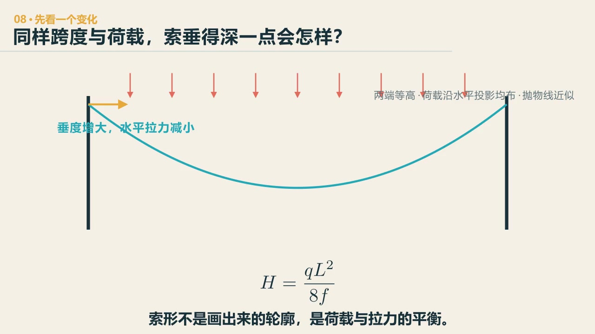
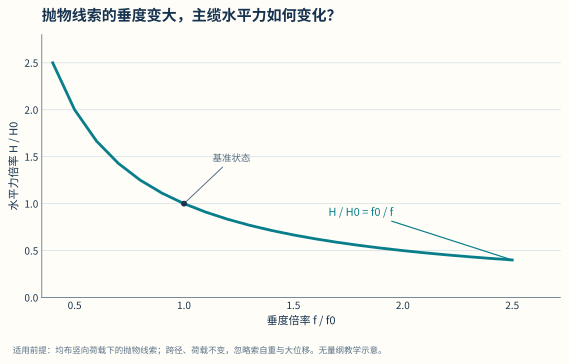
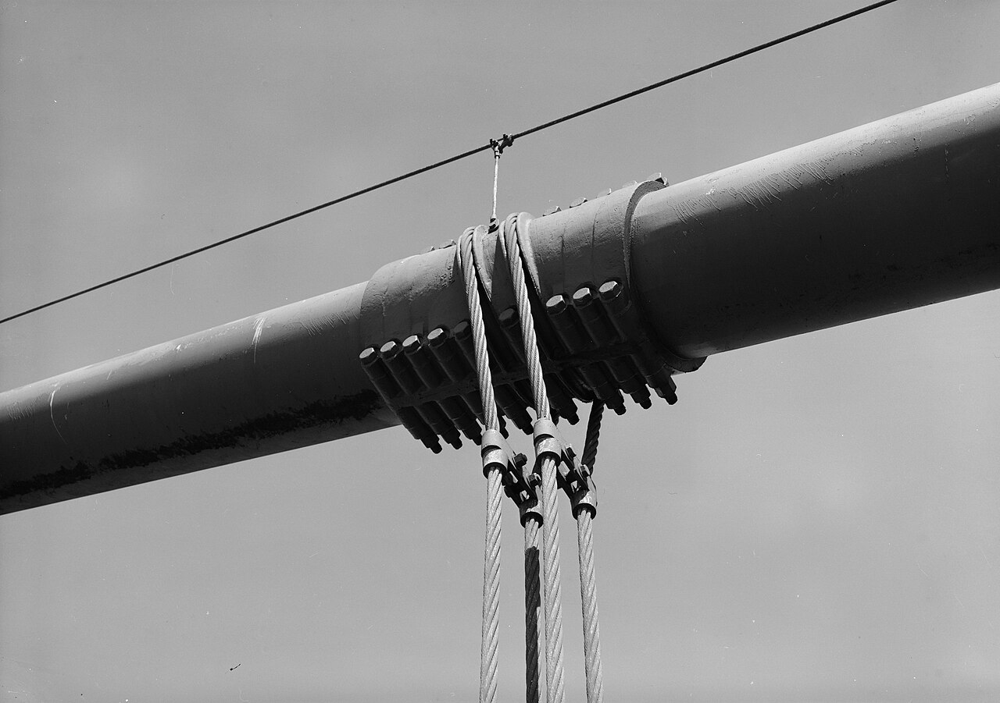

# 第 8 章　受拉：悬索桥为什么离不开锚碇

::: {.chapter-question data-term="锚碇"}
主缆把桥面吊起来了，它两头那股拼命往里拽的力，最后由谁接住？
:::

悬索桥的主缆主要受拉。材料在轴向受拉时能比较充分地工作，也不必像梁一样承担很大的弯曲。讲到这里，一个问题自然会来：

既然它效率这么高，为什么不把所有桥都建成悬索桥？

这比"悬索桥由哪些构件组成"更值得先问。

先问：跨度和重量都不变，把中间的索放得更低，索会更紧还是更松？

::: {.content-visible when-format="html"}

  <video controls preload="metadata" data-poster="../assets/videos/manim/08-cable-sag.jpg">
    <source src="../assets/videos/manim/08-cable-sag.mp4" type="video/mp4">
  </video>
  
<a href="../assets/code/manim/bridge_mechanics_series.py" download>下载动画源码</a><a href="../assets/code/manim/mechanics_scenes.md" download>下载分镜说明</a><a href="../assets/code/manim/README.md" download>下载运行说明</a>

:::

::: {.content-visible when-format="epub"}

:::

::: {.interactive-block}
<iframe src="../interactive/long-span-load-path.html?type=suspension" title="悬索桥桥面、横梁、加劲梁、吊索、主缆、桥塔和锚碇三维传力路径" height="790" loading="lazy"></iframe>

先用一根索看清垂度的代价，再依次切换“构造—追一股力—FEM 单元”：荷载从板和横梁进入加劲梁、吊索与主缆，竖向分量交给桥塔，水平分量最终进入锚碇。主缆恒载基准采用抛物线代理；未完成找形以前，不把显示值称为真实成桥索力。<a href="../interactive/long-span-load-path.html?type=suspension" target="_blank">全屏打开悬索桥模型</a>。

:::

## 同一辆车，为什么拉得更紧的索动得更少

前面的垂度公式比较的是不同初始索形。下面换一个问题：两根索跨度、垂度和材料完全相同，只让其中一根在车辆到来以前承受更大的恒载、形成更大的初张力。同一辆车压上去，它们还会动得一样多吗？

这里比较的是两个已经完成找形和调索的初始状态。为了让它们在不同恒载下仍有同样的初始垂度，两根索的无应力长度并不相同；否则我们偷偷改变的就不只是初张力，初始索形也会跟着变。

::: {.interactive-block}
<iframe src="../interactive/08-cable-geometric-stiffness.html" title="悬索初张力、材料伸长与重新找形对比" height="980" loading="lazy"></iframe>

橙色与蓝色模型承受同一附加荷载。先比较低、高恒载形成的初张力，再切换“固定初张力估算”和“伸长后重新找形”。虚线是加载前索形，实线按计算后的实际几何绘制；<a href="../interactive/08-cable-geometric-stiffness.html" target="_blank">全屏打开索几何刚度实验</a>。

:::

这里的“材料伸长”和“形状变化”不是两段可以直接相加的竖向变形。钢丝的轴向应变改变了索的当前长度；新的长度、荷载和端点又必须共同找到一条新的平衡曲线。所谓**几何刚度**，正是当前索力参与了后续增量平衡：原来已经拉得更紧，同一份附加荷载通常就更难把索形推离原位。

<figure class="data-figure">

<figcaption>垂度小，看起来平；代价是水平分力迅速增大。图采用水平投影均布荷载下的理想柔索关系。</figcaption>

<a href="../assets/data-figures/03-cable-sag-horizontal-force.csv" download>下载图中数据 CSV</a><a href="../assets/code/data-figures/generate_data_figures.py" download>下载绘图代码</a>

</figure>

索中间下垂的高度叫**垂度**；对水平投影均布荷载下的理想对称柔索，\(H=qL^2/(8f)\)，垂度增大时水平分力减小，但真实悬索桥还要同时考虑主缆长度、塔高、净空、刚度和施工条件。

## 一根晾衣绳不够

先看最简单的绳。它能拉，不能压，也几乎不能单独抵抗弯曲。把荷载挂上去，绳会改变形状，直到拉力与荷载平衡。课堂上我们经常用晾衣绳来讲它——两棵树之间挂一根绳，就是最朴素的悬索。

一座悬索桥还要有主缆、吊杆、加劲梁、桥塔、锚碇和桥面系。车辆先到加劲梁，经吊杆进入主缆；主缆把竖向分力交给塔，把很大的水平分力交给锚碇。主缆在塔顶经过索鞍改变方向，索鞍再把很大的竖向力和水平不平衡力交给桥塔。施工和特定工况中，主缆与鞍槽之间是否发生相对移动、怎样控制移动，要由摩擦、抗滑安全和具体构造决定，不能把它简单想成一根绳自由滑过轮子。金门大桥的主缆直径大约一米，而且不是一根粗钢筋，是许多细钢丝在空中纺成的。课堂上学生查到这一步的时候，都觉得挺不可思议。

::: {.real-bridge-figure}
{fig-alt="粗大的主缆下方由索夹连接数根竖向吊索"}

照片里最粗的不是一根实心钢棒，而是主缆；向下的细索把桥面荷载送上来。沿着一根吊索追到索夹，再沿主缆向两侧走，照片在塔和锚碇之前停住了，力路却不能停。Jet Lowe / HAER，美国公有领域作品。
:::

## 看起来像，不等于它在工作

课堂上我们看过五张"悬索桥"的图，让学生找不对劲的地方。有的主缆没有锚住，力没有去处；有的主缆是不连续的，中间断了一截；有的缺塔；有的吊杆只是装饰；还有的桥面其实由下方一根很刚的梁直接支承，索体系根本没有参与。

我不会让大家先背错误类型，而是问：如果把这个构件剪断（教学模型里的"剪断"，不是破坏建议），哪条力路先中断？剪掉吊杆，局部桥面怎样把荷载交给主缆？主缆没有锚碇，水平分力去哪里？主梁特别刚时，索体系还分到了多少荷载？

有座桥的中间设了一个锚碇，学生追着问了好几个星期——金门大桥中间不设，为什么这座桥要在中间设？有个学生给了我七八个答案，大部分是错的，但我觉得这个问题本身很有意思。它逼着我们把"水平分力由谁平衡"想清楚。

## 越柔，主缆越工作；然后呢

主梁做得柔一些，可以让主缆承担更多荷载，减少梁的弯曲用料。但柔度增加，变形和振动会更明显。塔科马海峡桥常被简单讲成“共振把桥吹垮”，这个说法不够——它真正提醒我们的是：把静力材料效率推到很远，同时会改变刚度、频率、阻尼和气动稳定。课堂上放过塔科马垮塌的视频：1940 年，跨度 853 米，主梁高跨比约 1:350；事故前几个月出现过较明显的竖向振动，垮塌当天则进入了大幅扭转的气动弹性失稳。两段“晃”不能只凭画面当成同一个机制。

课堂上做过一个特定的简化比较：同样跨 30 米、承担同一份荷载，按当时采用的材料许用条件估算，受弯梁约需 8.2 吨，受拉索约需 0.4 吨。这个数字不能脱离荷载、强度、垂度和变形要求拿去套别的桥，但“轴拉构件与受弯构件的材料需求可能相差一个数量级”很值得记住。可是为了这根很轻的索，你还得配塔、锚碇、吊杆、加劲梁和施工体系。课堂上有一个学生的回答很到位：索材只需把“进攻”练强，梁却要“攻防兼备”。

对水平投影上均布荷载的理想柔索，平衡可写成

$$
H\,y''(x)=-q,
$$

在水平分力 \(H\) 近似恒定时，线形是抛物线。对跨度 \(L\)、均布荷载 \(q\)、跨中垂度 \(f\) 的对称抛物线索，

$$
H=\frac{qL^2}{8f}.
$$

把垂度做大，\(H\) 减小，需要由锚碇平衡的水平分力和主缆拉力也会减小；但主缆更长，塔高、桥面净空和施工条件都会跟着改变。把垂度做小，桥看起来更平，水平力却迅速增加。一个参数的好处，常常带着另一项代价一起到来。

课堂上有个细节我记着：让六个人标出悬索桥最危险的位置，五个人选了同一处——吊杆。许多悬索桥的吊杆确实更容易受疲劳、腐蚀和反复弯折影响，也是可更换设计重点。更换时可以先用临时装置转移荷载，再卸下旧吊杆；具体做法要看桥型和施工方案。主缆一旦发生严重损伤，检查、隔离与修复会困难得多，但也不能一概写成“只能整根更换”。课堂上还讲过深中通道主缆附近起火的事件——它比电影里的破坏更具体地提醒我们，命脉构件的防护、检测和可达性都要提前想。

## 主梁的瘦身史

看悬索桥主梁的高跨比，能看见一段工程师的试错史：早期做到约 1/40，跨度一千米主梁就要二十五米高；后来做到 1/168，七八米；再激进到 1/350，三米——塔科马垮了；之后又退回来。课堂上我说过：工程师不是保守的，我们总想用更小的尺寸跨越更大的跨度，一直在试错。抗风不是后来附加的一章，它参与了悬索桥主梁为什么长成现在的断面。

## "够用"是很重要的词

悬索桥在超大跨径上有独特优势。可在十米、几十米的跨越上，锚碇、塔、主缆和吊杆可能远比问题本身复杂。材料效率不是结构选择的唯一排名。为了用上最喜欢的体系，先把问题做大，次序就反了。

::: {.chapter-method}
**只看一个构件省不省，很容易把代价搬到别处。** 轻了主缆，还要看锚碇、基础、施工和维护。电池、云服务、物流系统也一样：局部更省，不等于全系统更省。
:::

### 留给自己的一个动作

画一座最简悬索桥，只保留主缆、两座塔、锚碇、吊杆和加劲梁。任选一个构件涂黑，写出它退出以后最先失去的功能。再写一项其他构件能否暂时接手、接手到什么程度。

---
