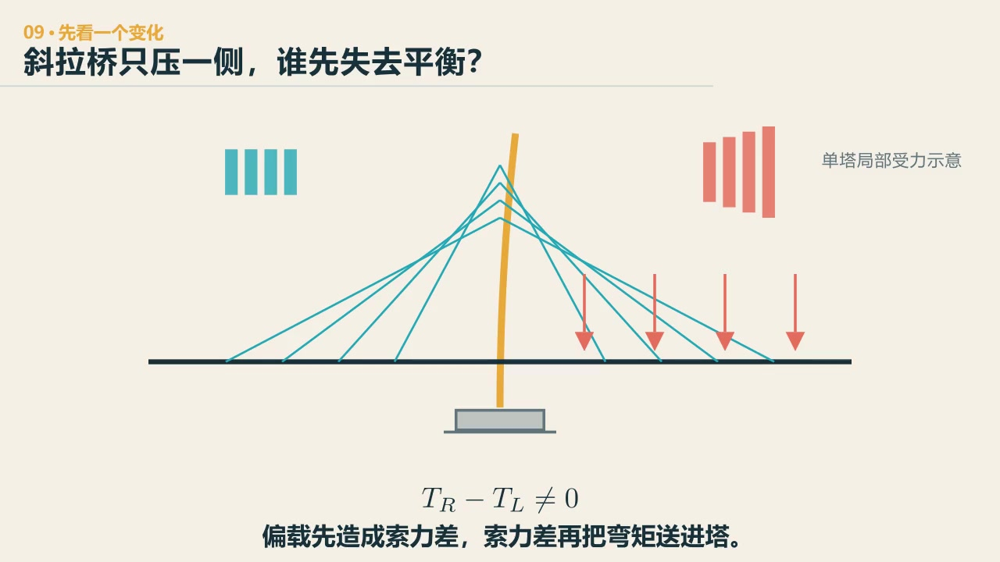
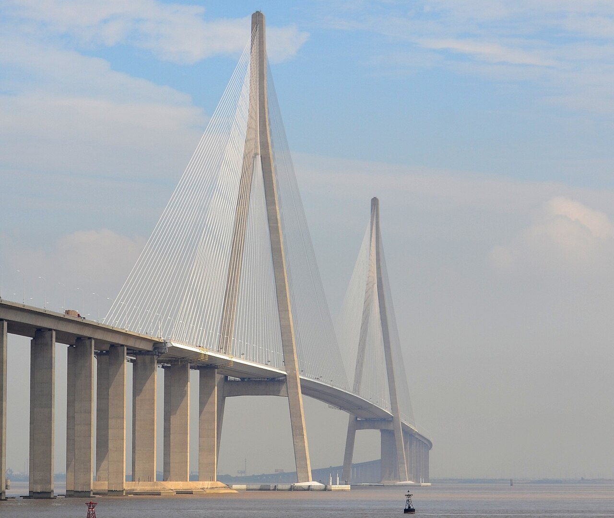

# 第 9 章　拉压组合：斜拉桥怎样把支点举到空中

::: {.chapter-question data-term="索角"}
斜拉索还是那些索。如果把桥塔削矮一截，为什么索力和主梁里的压力都会跟着变？
:::

四种主要桥型里，我个人会选斜拉桥。我毕业设计做的就是斜拉桥，它的构造和传力比较直接，我觉得有意思。

这个偏好可以说出来，但不能因为我喜欢，就跳过它的困难。

先问：只让桥塔一侧的桥面更重，桥塔会先向哪边偏？

::: {.content-visible when-format="html"}

  <video controls preload="metadata" data-poster="../assets/videos/manim/09-cable-stayed-balance.jpg">
    <source src="../assets/videos/manim/09-cable-stayed-balance.mp4" type="video/mp4">
  </video>
  
<a href="../assets/code/manim/bridge_mechanics_series.py" download>下载动画源码</a><a href="../assets/code/manim/mechanics_scenes.md" download>下载分镜说明</a><a href="../assets/code/manim/README.md" download>下载运行说明</a>

:::

::: {.content-visible when-format="epub"}

:::

::: {.interactive-block}
<iframe src="../interactive/long-span-load-path.html?type=cable" title="斜拉桥桥面板、纵横梁、锚固横梁、斜拉索、桥塔与基础三维传力路径" height="790" loading="lazy"></iframe>

先看一侧变重时塔怎样失去平衡，再切到“追一股力”：从轮载沿板、横梁、主梁、指定斜拉索、桥塔一直追到基础，同时看见索的水平分力怎样形成主梁轴压；N₀ 是明确标出的教学参考值。<a href="../interactive/long-span-load-path.html?type=cable" target="_blank">全屏打开斜拉桥模型</a>。

:::

两侧索力不再相等会形成**索力差**和塔的弯矩；动画只显示单一不平衡变化，真实响应还取决于边跨、塔梁连接、构件刚度和调索状态。

## 把十八根索拉成一样，桥面会自己顺下来吗

先做一个有点蛮横的实验：把所有初始索力调成同一个数。索还是那些索，桥也没有少一根杆件，主梁弯矩却未必肯安静下来。再把“调索程度”慢慢推向教学目标，看哪几根索先需要改、主梁上方的弯矩线怎样跟着变化。

::: {.interactive-block .interactive-block--wide data-layout="flow"}
<iframe src="../interactive/09-stay-force-moment-lab.html" title="斜拉桥索角、初始索力、索力增量与主梁弯矩三维实验" height="1040" loading="lazy" data-layout="flow"></iframe>

索力柱直接立在各桥面锚点旁：灰柱是按分担范围和索角得到的教学目标，黄柱是当前总索力；主梁弯矩图悬在梁上方。先把调索程度拉到零，再恢复到百分之百；随后比较边跨／主跨、塔高／主跨，以及辐射式、扇形和竖琴式布索。表格可展开查看每根索的 N₀、ΔN、N 和水平分量 N cosθ。模型是线弹性教学模型，不是实际成桥索力优化。若画面过窄，可<a href="../interactive/09-stay-force-moment-lab.html" target="_blank">全屏打开索力与弯矩实验</a>。

:::

这个实验先把两件容易混在一起的事拆开：索的**角度**决定同一竖向分量要付出多大拉力；索的**实际拉力分布**还要接住各自分担的桥面、初始调索、梁塔刚度和荷载位置。因此，索越平，在“承担同一份竖向作用”这个前提下确实越费力；但不能只凭照片里的斜率，就断定整座桥哪根索力最大。

## 空中的支点

一根斜拉索把主梁某一点拉向桥塔。从竖向看，它像给主梁增加了一个支点，使主梁的有效受弯跨度变短；从水平方向看，索力又把压力送进主梁。

设一根索的索力为 \(T\)，与水平线夹角为 \(\theta\)。它对梁提供的竖向分力是

$$
T_v=T\sin\theta,
$$

同时带来水平分力

$$
T_h=T\cos\theta.
$$

索越平，要获得同样的竖向支承，所需索力越大，水平分力也越大。于是塔高、索角、梁内轴压、索长和造价互相牵着。

课堂上有个学生做过一个很聪明的设计：用热气球把桥面吊起来。我说，这个想法其实已经摸到索体系的本质了——桥面被一股"向上的神秘力量"托举，至于那是什么，可以是热气球，可以是塔加拉索。斜拉桥就是给梁安排许多个空中的支点。

::: {.real-bridge-figure}
{fig-alt="苏通大桥两座高塔与扇形布置的斜拉索共同支承主梁"}

先别数索。任选一根斜拉索，把它对主梁的作用拆成向上的分力和沿桥向塔的分力。照片把“空中支点”拍得很清楚，却不会直接告诉你哪根索力最大。照片：Glabb，CC BY-SA 3.0，未修改、仅缩放。
:::

## 拉索一根根加上去，压力也在累积

课堂上我问过："悬索桥能到两千米，斜拉桥为什么不能？"这是它的核心问题。

把拉索从跨中向塔一根根加上去，每根索的水平分力都沿主梁向塔传递。越靠近塔，主梁中累积的轴向压力越大。跨度继续增长，这个压力会形成一个死循环：跨度越大，需要更多有效面积和更好的稳定条件抵抗轴力；截面增加又带来自重，自重再推高索力和轴力。空心箱形当然可以拿掉靠近中间的低效材料，还能把材料放到外围换取弯扭刚度和回转半径；可有效面积、局部稳定、加劲与连接不能一起挖掉。斜拉桥的跨径限制还包括索垂度、风、施工和疲劳，但主梁累积轴压是其中很重要的一条根。

同一个压力在不同尺度下也有两副面孔。对较小跨径的混凝土主梁，适量轴压可以像一份"免费的预应力"，帮助控制拉应力和裂缝；走到大跨度、细长主梁，它又可能成为稳定负担。课堂上讲过这个反向视角：主梁里的压力不一定是坏事，跨径不大时正好当预应力用。不能只给它贴"好"或"坏"的标签。

## 第一版倒了，问题才出现

游戏里第一次搭斜拉桥，最常见的失败是塔站不住。我自己也在建模软件里复刻过阿拉米罗桥——那种没有背索的后倾独塔桥。第一版模型没有把后倾塔的自重、施工阶段和真实塔梁体系完整放进去，塔一直往主跨方向倒；我只好临时给桥面补重量，才看见它勉强平衡。这个“补重量”是模型暴露缺项的过程，不是实桥靠铺装压住桥塔的工作原理。实桥后倾塔的自重与倾斜几何，本来就是平衡主跨拉索效应的重要部分。亲眼看着错误模型倒一次，比看十张正确构造图都清楚。

塔底有没有足够约束？索是不是连到了一个不能抵抗不平衡弯矩的位置？左右荷载是否平衡？索角是不是太小？桥塔、主梁和锚固有没有形成完整体系？如果一开始就给出一张正确构造图，学生可以照着搭出来，却未必知道那根构件为什么不能少。倒一次以后补上去，构造会变得有理由。

竖琴式、扇形和辐射形没有简单的总冠军。竖琴式整齐，塔上锚点分散；辐射式索角较有利，塔顶锚固集中；扇形常在两者之间取舍。布索还要看施工、索间距、锚固空间、疲劳、维护和景观。

## 少一根背索，或者多一座塔

课上讲过两类看起来很“高级”的斜拉桥。第一类是独塔向后倾，主跨一侧有拉索，后面却没有一排背索；第二类是多塔多跨，中间塔左右都有主跨，却没有普通边塔那种明确的边跨背向约束。名字不必先背，它们问的都是同一件事：原来的约束少了，谁来接班？

::: {.interactive-block .interactive-block--wide data-layout="flow"}
<iframe src="../interactive/09-special-system-balance.html" title="无背索独塔力矩平衡与多塔斜拉桥中塔刚度实验" height="1030" loading="lazy" sandbox="allow-scripts" data-layout="flow"></iframe>

第一个页签把主跨索群合成一根力，绕塔底比较主跨倾覆力矩、后倾桥塔自重和基础余下的力矩；第二个页签拿掉左右对称，比较什么都不加、稳定索、抗弯塔形和辅助墩。多塔页中的刚度是教学参数，只用于比较“约束加在哪里”，不用于给真实方案排名。若画面过窄，可<a href="../interactive/09-special-system-balance.html" target="_blank">全屏打开特殊斜拉体系实验</a>。

:::

无背索不是少算了一根索，而是把原来由背索完成的力矩平衡，分给后倾桥塔的自重、塔梁体系和基础。多塔桥也不是塔越多越硬：左右荷载对称时，中塔两侧的水平分量可以互相抵消；一旦一侧更重，缺少背向约束的中塔就容易产生较大纵向位移。课堂里比较过，提高塔梁刚度当然有作用，却可能费料而控制有限；稳定索、交叉索、改变塔形或辅助墩，是直接改变力路与约束的办法。单纯增加塔高，并不能自动补上这份刚度。

这件事可以带到桥外面。两个电机同步、两个人抬一张桌子、两条生产线共同供货，对称时许多问题会互相抵消，系统看起来很安静。判断它是不是真稳，不能只看对称工况；故意让一边少一点、慢一点或重一点，剩下的差额由谁接住，才会把真正的约束和薄弱处照出来。

## 边跨不是主跨的陪衬

主跨拉索把塔向主跨方向拉，边跨拉索和边跨结构要帮助平衡。若边跨太长、太柔，塔顶位移和主梁内力会增加；若边跨太短，锚固与局部受力又可能很集中。

还有一个容易被忽略的点：同样一座斜拉桥，施工顺序不同，主梁最后锁进去的内力可能不同。课上用过“先做边跨还是先做主跨”来说明这个问题，但不能把它记成一条放之四海而皆准的正负号规则。临时支承、合龙方式、张拉次序、温度和体系转换都会一起决定最终状态。自锚、地锚或混合锚固说的是力最后由桥体还是地基平衡，也要先说明具体桥型；施工顺序会影响它怎样建立，却不是名称本身的定义。成桥图上看不出来的东西，施工过程会替它写下来。

::: {.chapter-method}
**局部的角度一变，整个系统就要重新分账。** 吊车的绳角、飞机的推力方向、机器人的连杆位姿都不能只看那一根杆件；分力会把一个小改动送到全系统。
:::

### 留给自己的一个动作

在同一座单塔斜拉桥上，把塔高降低百分之二十，主跨、荷载和各锚点需要的竖向支承份额暂时不变。先判断索角、索力、水平分量和主梁轴压怎样变，再用一根索的分力关系检查。最后单独写一句：还缺哪些全桥条件，才有资格判断塔弯矩。

---
