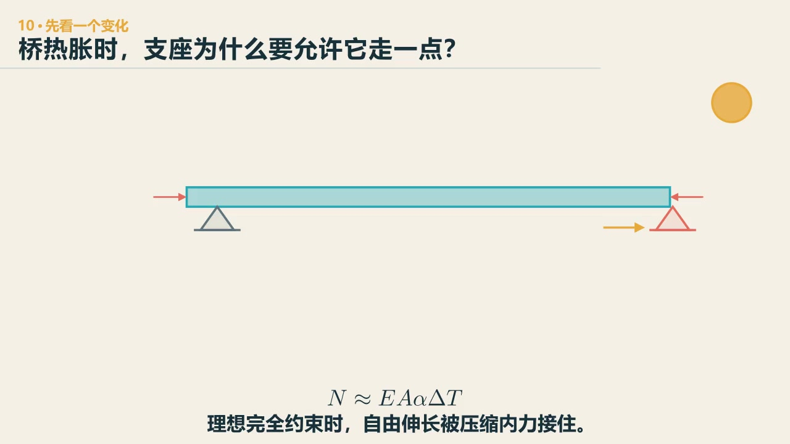

# 第 12 章　边界：支座为什么既要托住，又要放行

::: {.chapter-question data-term="温度约束"}
夏天中午，一百米的梁想长出约四厘米。如果两头都夹死，这四厘米去哪儿了？
:::

支座很容易被忽略。看桥的时候，大家先看到桥面、主梁和桥墩；梁和墩之间那一小层，常常像一个垫片。

课堂上让往届学生回忆桥梁由哪些部分组成，他们说了桥面、桥墩、基础——没有人想到支座。后来在课上，我们给支座起了个名字：隐形守护者。

可它要做的事并不小：上面几百吨、上千吨的荷载要通过它传下去，同时梁端还要转动，有时还要沿一个方向移动。课堂上我问过一个问题：为什么这个梁不能两端都固定？左边这样画、右边那样画，是为什么？

先问：天气变热时，梁想变长一点，哪一端应该给它留出路？

::: {.content-visible when-format="html"}

  <video controls preload="metadata" data-poster="../assets/videos/manim/10-temperature-supports.jpg">
    <source src="../assets/videos/manim/10-temperature-supports.mp4" type="video/mp4">
  </video>
  
<a href="../assets/code/manim/bridge_mechanics_series.py" download>下载动画源码</a><a href="../assets/code/manim/mechanics_scenes.md" download>下载分镜说明</a><a href="../assets/code/manim/README.md" download>下载运行说明</a>

:::

::: {.content-visible when-format="epub"}

:::

::: {.interactive-block}
<iframe src="../interactive/bridge-systems-atlas.html?mode=supports" title="连续梁温度伸缩与支座边界三维模型" height="760" loading="lazy"></iframe>

先看梁端为什么必须有出口，再让同一组温度变化分别经过“有路可动”和“两端锁住”的边界。约束应力为一维代理；<a href="../interactive/bridge-systems-atlas.html?mode=supports" target="_blank">全屏打开三维模型</a>。

:::

允许位移的一端叫**活动端**；自由热伸长可写成 \(\Delta L=\alpha L\Delta T\)，这个一维比较只说明温度边界的基本矛盾，真实支座还要处理转角、摩擦、收缩徐变和地震作用。

## 学生给出的答案

学生第一次回答这个问题时，给出的答案五花八门，而且和"越固定越稳"的直觉正好相反：有人说，如果都是活动的，梁走一走就掉下来了；有人说，都是固定的，容易产生脆性破坏；还有人说，都是固定的就是超静定结构，发生变形反而会造成相对大的破坏。

这些回答其实已经摸到答案了。支座一方面要传力，另一方面要释放温度、收缩徐变和转动。既不能全放开变成机构，也不能全锁死制造次内力。

先只看温度。长度为 \(L\) 的梁，温度变化 \(\Delta T\)，若可以自由伸缩，轴向变形大致为

$$
\Delta L=\alpha_T L\Delta T.
$$

课堂上算过一笔账：一百米的梁，温度升高三十度，沿桥长方向大约会自由伸长四公分（线膨胀系数按 \(1.3\times10^{-5}\) 左右算）。这个量不算小。课堂上还顺带讲了一个很浪漫的细节：钢筋混凝土之所以能共同工作，一个重要条件是钢筋和混凝土的线膨胀系数很接近——这是一个非常非常浪漫的偶然。

若两端完全锁死，变形被约束，温度作用会转成轴力和附加内力。真实结构还会有收缩徐变、支座沉降和梁端转角。固定得越多，不一定越安全。

## 一块橡胶为什么能承重又能转

课堂上我们用一瓶水演示过滚轮——圆的水瓶垫在梁下，梁就容易移动。真实支座的办法不只一种。板式橡胶支座看起来像一块黑色垫板，内部由橡胶层和钢板叠合：竖向靠受压传力，平移主要靠橡胶层剪切，转角则靠非均匀压缩来适应。需要释放较大位移时，滑板支座才会依靠聚四氟乙烯与不锈钢板等低摩擦滑动副。一个是材料自己剪切变形，一个是界面真的滑动，不能混成同一种机制。

学生里有一个回答我当场表扬了：支座类似于楼里的避震器。慢速的温度位移和快速的地震位移，对装置的要求可能不同——日常温度下允许结构"呼吸"，强震时又要提供控制。这就引出了减隔振支座这一类东西。

支座还会遇到一个特殊情况：在悬臂、偏载或某些连续体系里，支座反力可能变成向上的拔力，常常又与支点附近的负弯矩同时出现，但两者不是一回事。课堂上讨论过，可以靠恒载保持压紧，也可以布置抗拉支座或限位装置。还有一个维护细节：老式的钢支座是滚轴，时间久了轴会变形——但轴可以换。

## 地震来时，支座不能只会“滑”

温度变化很慢，梁有时间一点点伸长；地震来得快，上部结构的质量会产生惯性力。这个力要经过支座、限位装置和桥墩传到地基。若把桥墩和主梁锁得很紧，位移可能小一些，传下去的力却会变大；若把隔震层做得更柔，可以拉长周期、减少一部分地震力，但梁端位移会增加。还是原来的矛盾：力和位移不会同时免费变小。

因此，减隔震不是简单地把支座做得“更滑”。装置要在日常温度下允许活动，在地震时耗散能量或限制传力，还要给位移留出有限的行程。行程不够，支座或限位会发生碰撞；放得太开，梁端又可能越过支承范围，出现落梁风险。支座可以让桥动，却要知道允许它往哪里动、能动多远、最后由谁把它接住。

从这个角度看，抗震构造仍是边界条件的设计。我们不是只给模型选一个“固定”或“活动”的图标，而是在安排一条随时间和位移变化的力路：小位移时谁先工作，超过某个范围后谁接力，某一部件受损后桥面还会不会留在墩上。

## 换支座时，桥要短暂变成另一座桥

更换支座通常要用千斤顶临时顶起上部结构。顶在哪里、各点同步到什么程度、临时反力怎样进入梁和墩，都是新的施工状态。概念设计时给顶升位置和检修空间留余地，会让几十年后的工作容易很多。

支座若长期不能按设计发生位移——该剪切变形的不能剪切，该界面滑移的不能滑移——温度位移会去找别的出口，梁端、墩柱或伸缩缝可能出现异常；若支座脱空或偏压，反力分配又会改变。它不一定第一个破坏，却会让上部与下部之间的边界悄悄换掉。

::: {.chapter-method}
**被拦住的变形，会换一种方式变成力。** 钢轨、热管道、机械装配和电池膨胀都要问同一句：它想动的时候，我们到底给没给出口？
:::

### 留给自己的一个动作

画一座两跨连续梁的四个支座。从俯视图出发，用箭头标出每个支座允许的顺桥向和横桥向移动，再标出全桥至少由哪里提供纵、横向稳定。然后假设温度升高，检查你的箭头有没有互相打架。

---
