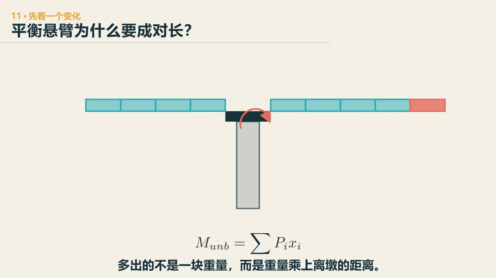

# 第 13 章　形成：桥不是一下子长成的

::: {.chapter-question data-term="施工阶段"}
桥墩两边各长出一段梁。为什么不能让左边先多长一节，明天再把右边补上？
:::

我们看桥，最常看到的是成桥照片。桥面已经连起来，线形很顺，支座也都在应该在的地方。

可桥不是一次出现的。第一块梁架上去时谁托着它？悬臂还没合龙时靠什么稳定？临时支架什么时候拆？这些状态里，结构的边界条件和内力可能与成桥完全不同。

讲施工的时候，我在课上放过一个标题，叫"最刺激的浪漫"——施工方法就是你想象不到的，很刺激。课堂上还讲过那个古老的谜语：什么东西早上四条腿，中午两条腿，晚上三条腿？答案是人。我说桥梁其实很像——整个过程中，它的结构体系是不断变化的。

先问：桥墩两边各伸出一段时，为什么要让它们尽量一起长？

::: {.content-visible when-format="html"}

  <video controls preload="metadata" data-poster="../assets/videos/manim/11-cantilever-balance.jpg">
    <source src="../assets/videos/manim/11-cantilever-balance.mp4" type="video/mp4">
  </video>
  
<a href="../assets/code/manim/bridge_mechanics_series.py" download>下载动画源码</a><a href="../assets/code/manim/mechanics_scenes.md" download>下载分镜说明</a><a href="../assets/code/manim/README.md" download>下载运行说明</a>

:::

::: {.content-visible when-format="epub"}

:::

::: {.interactive-block}
<iframe src="../interactive/bridge-systems-atlas.html?mode=construction" title="平衡悬臂施工节段与墩顶不平衡三维模型" height="760" loading="lazy"></iframe>

先看单侧多一个节段会怎样失去平衡，再拖动施工节段，故意让一侧多一段。力矩指标只比较施工状态趋势。<a href="../interactive/bridge-systems-atlas.html?mode=construction" target="_blank">全屏打开三维模型</a>。

:::

两边重量对桥墩的转动作用要彼此抵消，这就是**平衡悬臂**的基本要求；不平衡时可用 \(M_u=\sum P_i x_i\) 估计趋势，但临时固结、施工荷载、风和材料状态必须在实际施工方案中单独核算。

## 现场的感受

我第一次真正走到还没有完全成形的桥面上，感觉和课本很不一样。梁已经架起来了，栏杆还没有；有些位置为了后续拼接，脚下还留着孔洞。风从桥面吹过来，人站在那里会有点发颤。图纸上那根干净的粗线，到了现场忽然有了高度、空洞和脚下的声音。

更有意思的是，我学了很多年桥梁以后，到了梁场和桥面上，仍会看见不少一时说不清用途的孔洞和钢筋。这不丢人。它提醒我，施工不是把设计图放大以后照着做；每一个吊点、临时孔、预埋件和工作平台，都在服务某个具体过程。若只看成桥，它们要么已经消失，要么很容易被误认成"多余的构造"。

现场还有一个插曲：我们一起去拍梁场，那天风特别大，无人机起飞就"爆"了——直接被吹飞。风大，飞机崩了，后来我们买了第二架，大疆的。

## 同一座连续梁，可以有不同的来历

一座三跨连续梁，可以现场整体浇筑，可以先简支后连续，可以悬臂浇筑或拼装，也可能顶推到位。

二期铺装等成桥后施加的荷载，在最终连续体系上产生内力；自重却可能在不同施工体系中逐步进入。先简支后连续时，早期梁段自重先按简支状态承担；悬臂施工时，自重沿悬臂状态累积；合龙以后，后续荷载才按新的连续体系分配。

课堂上我问过一个投票题：通过不同方式搭建的连续梁，结构自重产生的内力分布一致吗？答案是：不一定——只有顶推和一次成桥是完全一致的。成桥外形相同，自重内力和锁定状态未必相同。只用一个终态模型把全部荷载一次施加，会把历史抹掉。

课上还讲过两句话来记这个事。一句是存钱：结婚之前挣的钱全是自己的，结婚以后挣的要两个人分——内力也是从小积累的，每一阶段的荷载在自己当时的结构体系里留下账。另一句是材料：混凝土没结硬的时候，它只是一个重量，不是你的结构——它从一滩烂泥变成一个坚硬无比的结构，中间那一滩，什么力都扛不了。

在线弹性、阶段之间关系明确的简化模型中，可以把最终效应理解为各阶段增量的累加：

$$
S_{\mathrm{final}}=\sum_{j=1}^{n}\Delta S_j.
$$

关键在于，每个 \(\Delta S_j\) 要在当时的结构体系、支承和材料状态下计算。真实施工还会有混凝土龄期、收缩徐变、预应力损失、温度和几何非线性，简单相加不再够用。但先把"荷载在哪个结构状态进入"写清楚，已经能避免把所有东西一次倒进终态模型。

## 模型翻倒，是一次很好的暂停

课堂上用游戏演示悬臂施工时，有一版只放了一个普通支座，梁刚向一边伸出就翻倒了。这个失败把"临时固结"叫了出来：成桥以后可以允许的转动，在悬臂施工时可能必须先锁住。

悬臂最不平衡的时候，桥墩和临时连接要承担很大的弯矩。左右对称施工能减小不平衡，但施工误差、材料运输和风都可能打破对称。合龙以前，不能提前借用完整连续梁或完整拱的能力。

讲到悬臂伸出一段时，我会停下来，让学生先判断这一段弯矩应该是什么样——我随便找一个同学上来画。动画在临时固结拆除、合龙和支承转换处停一下，比一路"很壮观"地放完有用得多。

## 顶推时，一截梁会轮流经历正、负弯矩

顶推施工常在岸上逐段制作梁体，再用千斤顶向前推。前端伸出桥墩时像一个长悬臂，负弯矩很大。加一段较轻的钢导梁，可以让前端更早搭上下一桥墩，减小主梁最不利悬臂状态。

同一截面在推进过程中会轮流经过跨中和支点附近，正、负弯矩都可能出现。这也是顶推梁常采用等截面、预应力布置要兼顾不同符号弯矩的原因之一。

::: {.interactive-block .interactive-block--wide data-layout="flow"}
<iframe src="../interactive/13-incremental-launching-moment-lab.html" title="连续梁顶推施工阶段、截面弯矩历程与导梁参数实验" height="1280" loading="lazy" sandbox="allow-scripts" data-layout="flow"></iframe>

先盯住一截梁，让它越过两个支点；再分别改变导梁的长度、线重和刚度。图中弯矩采用 (M/(qL^2)) 归一化，只用于比较施工阶段的趋势。<a href="../interactive/13-incremental-launching-moment-lab.html" target="_blank">单独打开实验</a>。

:::

各种施工方法各有优劣。课堂上给过一个真实的选择题现场：不同的施工方式，自重内力分布一不一样？同学们投票，答案是不一定。悬臂法减少落地支架，却提高施工控制要求；顶推减少桥下作业，却让梁承受反复变化的施工内力；整体支架法直观，但场地、通航和地基未必允许——而且支架是按吨按天算钱的，桥烂尾了，放置时间越来越长，造价可能超过它本身。

## 设计图里要有时间

结构图通常把空间画得很好，时间却只藏在施工说明里。概念阶段至少可以画四格：

1. 第一批永久构件由谁托住；
2. 最大悬臂或最不平衡状态；
3. 合龙、张拉或支承转换；
4. 临时构件退出后的最终体系。

每一格只写当前支承、主要荷载和下一步转换条件。若某一格必须假定"此时已经是成桥"，说明问题还没有回答。

课堂上还有一个量级印象：跨度 200 米的桥，如果合龙时有一度的转角误差，乘以 100 米量级的臂长，高差就很可观。合龙不是动画里"咔哒"一声接上，是标高、间距、转角和温度窗口的账。

::: {.chapter-method}
**最后的样子一样，不等于走过的过程一样。** 金属热处理、药物给药顺序、资金逐步投入都有路径依赖；过程中在哪个状态加上了什么，会留在最后的结果里。
:::

### 留给自己的一个动作

选顶推、悬臂、转体或先简支后连续中的一种，画四帧施工状态。每帧圈出当前最危险的接口，不要求算数值。最后说明：成桥照里哪一个构件曾经承担过完全不同的角色？

---
