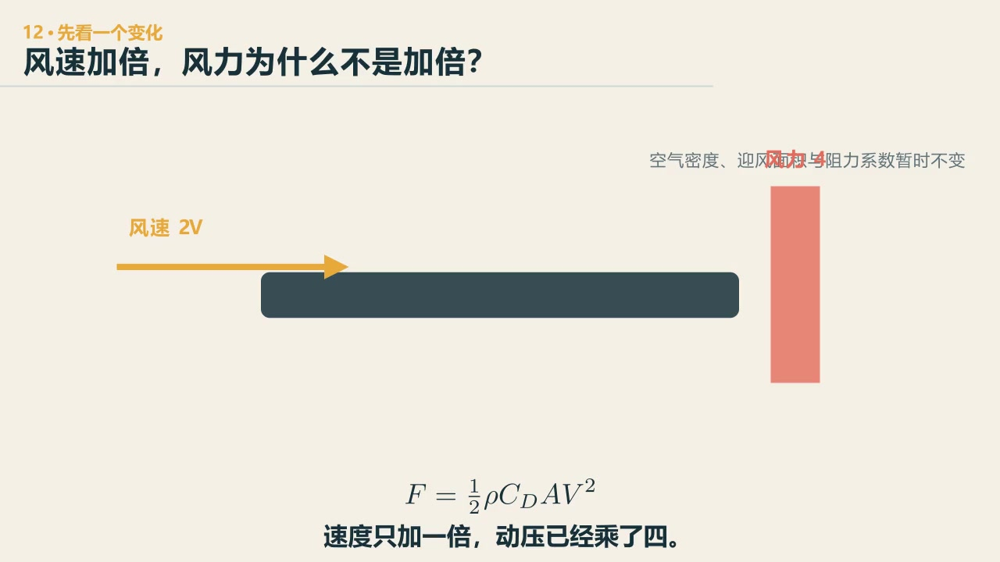
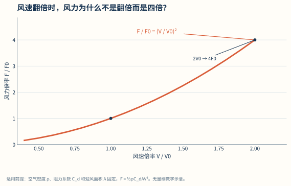
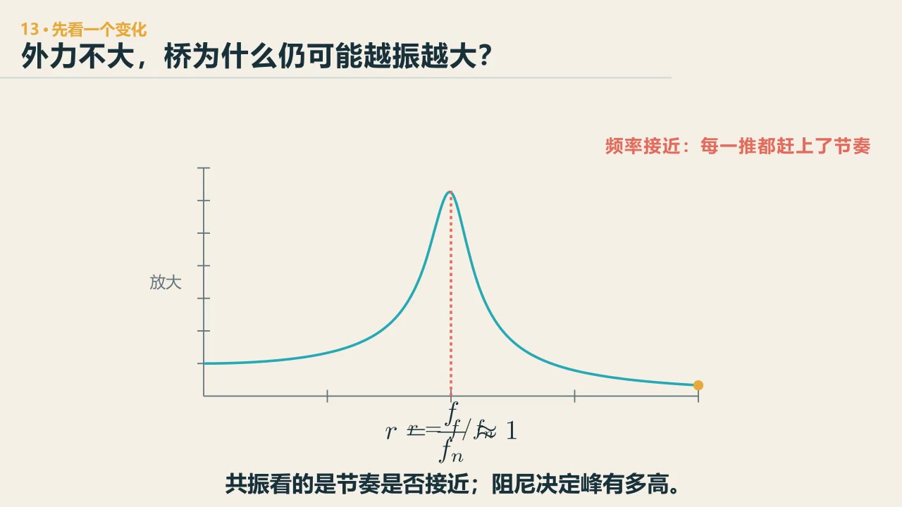
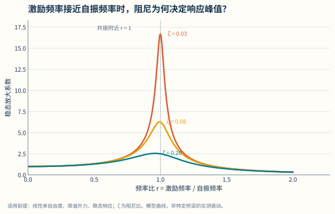
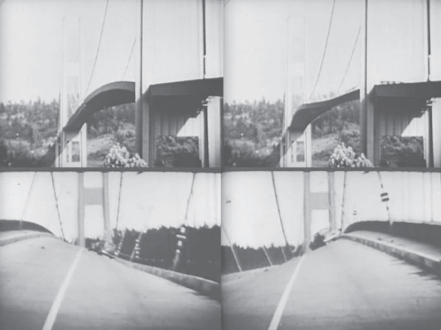

# 第 16 章　耦合：风为什么不是一个固定箭头

::: {.chapter-question data-term="耦合"}
风并没有吹到最大，桥为什么反而突然开始拧着晃？
:::

桥梁抗风课第一节课，我是从黑神话悟空讲起的——黄风大圣的三味神风，需要定风珠这个法宝才能破。然后我问大家：你有没有玩过？风也是这个道理，它不会因为你不喜欢就不来。

在大连，这个话题不难进入。大连有句老话：风一年吹一次，一次吹一年。天气预报写五到六级、阵风七到九级，站在海边的感觉和教科书里一根水平箭头不太一样。

桥梁计算图上常把风画成一排箭头，这是必要的简化。问题是，画完以后很容易忘记：真实的风会随时间、空间和高度变化，也会被地形、建筑和桥梁本身改变。风不是图上一根水平箭头。

先问：风速从十米每秒变成二十米每秒，桥受到的风力会增加几倍？

::: {.content-visible when-format="html"}

  <video controls preload="metadata" data-poster="../assets/videos/manim/12-wind-square.jpg">
    <source src="../assets/videos/manim/12-wind-square.mp4" type="video/mp4">
  </video>
  
<a href="../assets/code/manim/bridge_mechanics_series.py" download>下载动画源码</a><a href="../assets/code/manim/mechanics_scenes.md" download>下载分镜说明</a><a href="../assets/code/manim/README.md" download>下载运行说明</a>

:::

::: {.content-visible when-format="epub"}

:::

::: {.interactive-block}
<iframe src="../interactive/modeling-lab.html?mode=wind" title="风速、阻尼、频率比与动力放大实验" height="730" loading="lazy"></iframe>

先看风速为何不按一倍一倍地长，再看 U²，并把频率比推近 1。单自由度模型不计算颤振、驰振或涡振临界风速；<a href="../interactive/modeling-lab.html?mode=wind" target="_blank">单独打开风实验台</a>。

:::

<figure class="data-figure">

<figcaption>同一断面、同一攻角的数量级比较：风速翻倍，平均气动力约为四倍。</figcaption>

<a href="../assets/data-figures/04-wind-speed-square-law.csv" download>下载图中数据 CSV</a><a href="../assets/code/data-figures/generate_data_figures.py" download>下载绘图代码</a>

</figure>

这叫风力的**平方关系**：在空气密度、参考面积和阻力系数不变时，\(F\propto V^2\)；实际断面的外形、攻角、雷诺数和附属物会改变气动力。

## 风速增加一倍，力不是增加一倍

先看最基本的数量关系。对给定空气密度、参考面积和阻力系数，平均气动力常可写成

$$
F_D=\frac12\rho U^2 C_D A.
$$

风速 \(U\) 从十米每秒增加到二十米每秒，其他条件暂时不变，力增加到四倍。这个平方关系是抗风里很重要的数量感。课堂上还提过一句：风速只有八到十米每秒，这样的"平常风"也能让桥出问题——不是只有百年一遇的风才危险。

不过 \(C_D\) 不是永远不变，桥面攻角、断面形状、雷诺数和附属物都会影响气动力。公式先告诉我们风速平方的敏感性，不替代具体断面的试验和分析。

## 平均值以外，还有波动

风速可以粗略分成平均部分和脉动部分：

$$
U(t)=\bar U+u'(t).
$$

课堂上用班级平均成绩讲过这个：平均分都是六十分，可能大家都差不多，也可能有人挂科有人考八十——平均值相同，波动结构完全不同。描述波动，用标准差除以平均值，叫湍流强度。

平均风可以造成平均位移、扭转和静力气动效应；脉动风携带一段频率范围，会激起结构的随机振动。低频的涡大，能同时把桥的两头罩住；高频的涡小，这边最大那边未必最大——所以不能拿一个风速时程复制到全跨。这部分数学会多一些，但还是先抓关系：输入能量集中在哪些频率，桥自己的固有频率在哪里，阻尼能耗掉多少。

## 先把"振得很大"分开

课堂视频里桥一动，最容易说"共振了"。这个词有时对，有时把几种不同现象混在一起。

先别急着往下面找定义。把同一段“桥在晃”的画面分别放进四种机制，调风速、阻尼和断面外形，看哪些现象随着风一直存在，哪些只在一段风速突出，哪些需要运动反馈超过耗散才会增长。实验给出的频谱和能量只作定性辨识，数值不对应某一座实桥。

::: {.interactive-block}
<iframe src="../interactive/wind-phenomena-lab.html" title="平均风、抖振、涡激振动与颤振定性辨识实验" height="900" loading="lazy"></iframe>

先操作再命名：同样是“晃”，要看输入、频率随风速的变化和能量反馈；<a href="../interactive/wind-phenomena-lab.html" target="_blank">单独打开风致现象实验</a>。

:::

先问：用同样轻重、同样快慢的反复推力，什么时候桥的摆动会特别大？

::: {.content-visible when-format="html"}

  <video controls preload="metadata" data-poster="../assets/videos/manim/13-resonance.jpg">
    <source src="../assets/videos/manim/13-resonance.mp4" type="video/mp4">
  </video>
  
<a href="../assets/code/manim/bridge_mechanics_series.py" download>下载动画源码</a><a href="../assets/code/manim/mechanics_scenes.md" download>下载分镜说明</a><a href="../assets/code/manim/README.md" download>下载运行说明</a>

:::

::: {.content-visible when-format="epub"}

:::

<figure class="data-figure">

<figcaption>峰值不是“风越大越危险”的同义词。它先提醒我们比较外力频率、固有频率和阻尼。</figcaption>

<a href="../assets/data-figures/05-single_dof_dynamic-amplification.csv" download>下载图中数据 CSV</a><a href="../assets/code/data-figures/generate_data_figures.py" download>下载绘图代码</a>

</figure>

外力频率接近结构自身频率时的放大叫**共振**，频率比可写为 \(r=f/f_n\)；短片只对应线性单自由度、受迫振动的入口，不能用来直接判断桥梁的涡振或颤振。

对一个线性单自由度模型，

$$
m\ddot x+c\dot x+kx=F(t),
$$

若外力频率接近固有频率，稳态响应会被放大，阻尼决定峰值有多高——课堂上讲过，阻尼比降一半，动力放大系数可能翻一倍。这是理解受迫振动的入口，但桥梁风致振动还要继续分。

**平均静风效应**是平均气动力造成的平均变形及可能的静力失稳。

**抖振**主要来自来流湍流这个外部随机输入。自然风里普遍有速度脉动，桥也就会有不同程度的抖振；桥按自己的频率、振型和阻尼把这团杂乱的输入筛一遍，在接近自振频率的成分上反应得更明显。

**涡激振动**与钝体尾流交替脱涡有关。静止断面的特征脱涡频率常用

$$
f_s=St\frac{U}{D}
$$

作数量级描述。这里的 \(D\) 是断面的特征尺寸，\(St\) 是斯脱罗哈数，它会随断面形状和雷诺数等条件改变。课堂上说得更直白：尾流的特征频率大体随风速提高。它接近结构频率时，流固耦合可能出现锁定；离开锁定区以后，振动常常会减弱。这一点和“风越大、响应必然越大”的直觉不同，但它不是一条不问断面和工况的绝对规律。

**颤振**更麻烦。结构一动，气动力跟着改变；改变后的气动力又影响下一周期的运动。若运动相关气动力每周期输入的能量超过结构耗散，振幅会增长。问题已经进入运动—气动力的反馈稳定，和简单的外部周期力共振不同。

## 桥不止一个自由度

前面的 \(m\ddot x+c\dot x+kx=F(t)\) 很有用，但它只保留了一个运动方向。真实桥梁可以竖向弯、横向摆、扭转，桥塔和主梁还可能以不同节奏一起动。把这些自由度放回来，方程就写成

$$
\mathbf M\ddot{\mathbf u}+\mathbf C\dot{\mathbf u}+\mathbf K\mathbf u=\mathbf F(t).
$$

矩阵看起来多了一层，其实问题仍很朴素：质量怎样分布，哪些地方难变形，能量从哪里进来、又在哪里耗掉。模态就是这套系统比较自然的几种“整桥动作”。第一竖弯振型不是桥上某一点的频率，而是一整套点怎样一起上、一起下；扭转振型则要看桥面两侧的相位是否相反。测一个点，很可能把另一种动作漏掉。

这也解释了为什么只看一段视频说“桥晃得很大”还不够。要估振幅，也要看周期；要看桥面是整体上下，还是两侧一上一下；还要比较各测点的相位。颤振尤其可能是竖弯与扭转之间的耦合：单自由度模型能帮我们理解共振和阻尼，却不能替多自由度系统给这种耦合下结论。

用力学的语言说，把运动写成若干模态的组合，叫**模态叠加**；每一种模态有自己的频率、振型和阻尼。它们不是软件结果表里几行需要背的数字，而是桥最愿意怎样动的几种方式。

课堂上还放过塔科马桥垮塌的视频：1940 年，跨度 853 米，主梁高跨比约 1:350。垮塌当天，中跨北侧主缆的索夹（cable band）发生滑移；桥面由竖向波动转入大幅扭转运动，最后垮掉。事故前几个月出现过较明显的竖向振动，垮塌当天则进入扭转气动弹性失稳。两段现象不能只凭“都在晃”并成同一个名字。课堂上真正值得留下的是：它们的能量来源、频率特征和控制办法不同，不能用同一张“加大阻尼就好了”的卡片处理。这里的构件与事件表述据 [WSDOT 的事故史料总结](https://wsdot.wa.gov/TNBhistory/bridges-failure.htm) 校正；对失效精确机理，资料本身也保留了争议。

::: {.real-bridge-figure}
{fig-alt="四帧黑白历史影像显示塔科马海峡桥桥面发生明显扭转"}

四帧图已经足够证明桥面发生了明显扭转，却仍不足以只凭画面给气动机制定名。还要把风速、频率、振型、相位和每周期能量放回来。原始影像：Barney Elliott；本图 CC0。
:::

## 水马拆了，为什么还在振

虎门大桥异常振动时，临时水马是很显眼的断面变化。当时专家组的研判（也是群里大家的第一个反应）很直接：断面外形被水马改变了，把水马拆掉，应该就没问题了。

水马拆除了，当天晚上桥还在震。大家都有点慌——这已经超出最初“拆了就好”的判断。2025 年的课上我回忆过：大概过了一个小时，群里回查，说还是有问题。新的事实一出来，原来的解释就得往后退一步。

后续的证据比“拆了水马”复杂得多。振动以后，实测阻尼比一度降到原来的一半左右，按简单单自由度的想法，动力放大就可能接近翻倍。这提醒我们：变化的不只是断面外形，结构的耗能状态也可能变了。

模型试验也没有整齐地给出同一个答案。同一座桥，1:50 和 1:20 两种缩尺模型的结果可能明显不同；不同单位给出的曲线也有差异。我把问题原样交给学生：“我到底信哪个？”先别把三条曲线平均掉，要比较模型比例、相似条件、来流湍流、攻角、结构阻尼，以及栏杆、水马等附属物是否一致。2024 年的桥梁工程课上我还说过一句很直接的话：不管是哪个名校、哪个权威单位，实验结果都可以被怀疑；但要把结果真实地摆出来，让人质疑、讨论。单位的名字不能替代证据。

课上我还讲过一段听来的现场细节：有位学流体力学的领导来，问了一句“这是什么涡？”涡有很多类型，把汇报的人问住了。大家笑过以后，问题留下来了：说“涡振”之前，得先分清楚是哪一种涡。学生提过“用装满货物的卡车压桥”，我调侃他“你已经可以当省长了”——工程处置中还真的在桥面上布置了四十六台重车。

导流板的安装也很有意思：风洞实验做得再充分，实桥上也是八百米一点一点装，看着流场有没有变——最开始用木头，加工快，最后再替换成钢板。

## CFD 画得很漂亮，然后呢

CFD 很容易给出有吸引力的流线、涡量和压力云图。课堂上我也愿意让学生用它看桥梁断面后面的分离和涡脱落，因为很多看不见的流动一下子有了形状。

但一张瞬时云图只能说明某个模型、某个时刻的计算状态。课堂上做过网格对比：二十个单元和五个单元的结果一样吗？风速一高，五个单元的结果就发散了。入口湍流怎样给，计算域多大，网格在壁面和尾流区够不够，时间步长是否收敛，湍流模型能不能描述当前分离，断面附属物有没有保留——这些都会改变结果。课堂上还有一句原话：算出来的结果不一定对，就算算一百个小时也可能是错的。

可以先做一个很便宜的检查：同一断面选两个风速，比较尾流主频是否大致随风速移动；再改变网格与时间步长，看力系数和频谱是否稳定。便宜的检查若过不了，漂亮的云图暂时没有多少说服力。

CFD 擅长帮助我们看机制和参数敏感性，风洞擅长在可控相似条件下测量，现场给出真实边界下的响应。它们不一致，正好把工作带到下一步。

## 抗风措施先问改了哪一项

改变断面外形、加导流构造、提高刚度、增加阻尼、改变质量、设置调谐质量阻尼器，都可能降低某类响应。选措施以前，先说它改了方程里的哪一项，针对的是哪一种现象。课堂上把措施按机制放过：改质量、刚度、阻尼，改断面面积和气动力系数，或者引入控制力——不重不漏地想问题。课程总结里还说过：数字仿真和风洞实验都是评价手段，不是措施本身。

第一节课我说，这门课有点像土木工程里的“定风珠”。风是十七级，它就是会来；抗风不是把风定住，是理解它怎样把能量送进结构，再决定在哪里截住。

::: {.chapter-method}
危险不只取决于外面的输入有多大，还要看系统会不会把它放大。风、声音、电路、市场波动都一样：先看输入，再看系统自己的节奏和耗散能力。
:::

### 留给自己的一个动作

找一段桥梁振动视频，先不要命名。只列出你能从视频直接看见的量，以及为了区分抖振、涡振和颤振还缺什么数据。至少写出风速时程、响应频率、振型和衰减或能量信息中的两项。

---
