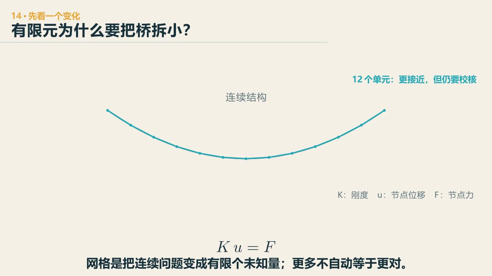
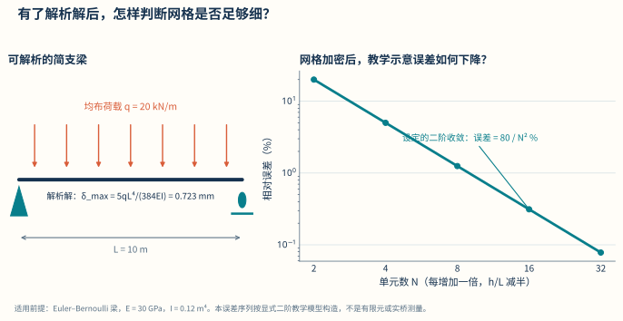

# 第 18 章　证据：有限元和 AI 的结果，为什么还要怀疑

::: {.chapter-question data-term="验证"}
一张云图很漂亮，软件也没有报错。第一眼，你会先查哪儿？
:::

有限元软件最容易让人安心的时刻，是计算完成、屏幕出现一张颜色很完整的云图。

可"算完了"和"算对了"之间，还有一段路。

课堂上我说，验证软件，先做一个简单工况——像拿到计算器先问一加一是不是等于二。简单工况都对不上，直接上整桥复杂模型，错误只会藏得更深。

展开高级案例：用桥面壳有限元追一组移动轮载

<iframe src="../interactive/bridge-shell-mitc4.html" title="移动列车作用下桥面 MITC4 平壳有限元响应" height="870" loading="lazy"></iframe>

这是从“20260721数字孪生”并入的可复算桥面模型：四节点 MITC4 平壳、移动轴列、固定全过程色标、轮载合力与一阶矩守恒。先读完下面“能运行—定性定量—闭式基准”三层检查，再回来用它观察板的双向分配和局部响应。<a href="../interactive/bridge-shell-mitc4.html" target="_blank">全屏打开完整求解器</a>。

## 第一层：能运行

模型不报错，只说明求解器得到了一个数学结果。它没有替我们确认材料、单元、连接、边界和荷载是我们想要的。有些错误反而很安静：漏掉自重，模型照样算；把两个节点放在同一位置却未连接，软件也可能各算各的；支座多锁一个方向，云图仍然连续。最危险的不一定是红色报错框，而是一个看起来很顺的错误答案。

## 第二层：定性、定量

课堂上我常把最先的检查分成"定性、定量"。

定性看变形方向、反力位置、受拉受压是否符合基本力路。对称模型在对称荷载下出现很强不对称，先查模型；一根向下受载的简支梁整体向上飞，也不必继续解释。课堂上原话是：节点都飞了，你定性就知道它不对。

定量先做总平衡：

$$
\sum R_y \approx \sum P_y.
$$

再看单位和量纲。毫米与米、牛与千牛、密度与重度混一次，结果可能差三个数量级。软件不会觉得这个数字奇怪。

先问：把一根梁切成更多小段，答案会立刻变得更可信吗？

::: {.content-visible when-format="html"}

  <video controls preload="metadata" data-poster="../assets/videos/manim/14-fem-discretization.jpg">
    <source src="../assets/videos/manim/14-fem-discretization.mp4" type="video/mp4">
  </video>
  
<a href="../assets/code/manim/bridge_mechanics_series.py" download>下载动画源码</a><a href="../assets/code/manim/mechanics_scenes.md" download>下载分镜说明</a><a href="../assets/code/manim/README.md" download>下载运行说明</a>

:::

::: {.content-visible when-format="epub"}

:::

::: {.interactive-block}
<iframe src="../interactive/modeling-lab.html?mode=fem" title="Euler-Bernoulli 梁有限元网格、平衡和闭式解校核" height="760" loading="lazy"></iframe>

先看同一根梁怎样逐步逼近，再回到一根梁做“一加一”检查：实际组装梁单元刚度矩阵与一致荷载；可以故意漏自重或锁死转角，再看平衡、闭式解和网格趋势分别能发现什么。<a href="../interactive/modeling-lab.html?mode=fem" target="_blank">单独打开梁 FEM 审核台</a>。

:::

<figure class="data-figure">

<figcaption>单元更多不自动等于正确；先看结果是否向可解释的基准收敛，再讨论整桥模型。</figcaption>

<a href="../assets/data-figures/06-simply-supported-beam-mesh-convergence.csv" download>下载图中数据 CSV</a><a href="../assets/code/data-figures/generate_data_figures.py" download>下载绘图代码</a>

</figure>

把连续结构拆成小单元叫**有限元离散**，可写成 \(Ku=F\)；单元加密后要看目标响应是否收敛，而不是只追求单元数量，复杂桥梁还受单元类型、连接、边界和荷载模型影响。

## 第三层：回到会手算的问题

取模型中的一根简支梁、一个悬臂或一个对称子结构，与理论解比较。比如均布荷载简支梁的跨中弯矩与挠度：

$$
M_{\max}=\frac{qL^2}{8},\qquad
\delta_{\max}=\frac{5qL^4}{384EI}.
$$

不要求每个复杂模型都有闭式解，但至少要有一个它应当做对的“一加一”。接着改一个参数：\(E\) 加倍，线弹性梁的位移应大致减半；荷载加倍，内力和位移应按线性关系变化；把支座释放，弯矩分布应有方向明确的改变。趋势不对，比某一个漂亮的绝对值更值得先查。课堂上还讲过网格无关化：单元画细以后，**你准备用来作结论的那个响应**还变不变？整体位移已经稳定，不等于孔边应力、支座反力或屈曲特征值也稳定。只有当目标响应的变化小于事先规定的容许值，粗网格才够回答这个问题。

最后再和另一个工具、试验、监测或独立建模比较。课堂上叫"平行计算"：用另一种方式又算一遍，结果一样当然最好；不一样，就互相检查。两个软件给出一样的结果也不自动证明正确——若两边用了同一个错误假设，它们可以很一致。

## AI 是另一张待审的答卷

AI 可以写代码、建参数化模型、解释公式，也可以很快给出一份结构分析流程。它把重复计算和第一版整理变得容易，这是好事。

但我在课上会追问："你有没有自己输进去一些想法，或者自己来评估一下这个结论？"如果只是把同一个通用问题交给 AI，再把回答原样交回来，换一个人也能得到很接近的内容。课堂上还演示过：让 AI 查混凝土强度设计值，三个数全错了——单位、两位小数，全不对。AI 可能知道，也可能不知道，所以不能假设它知道。

审查 AI 结果，可以先问四句：它用了什么模型和假设？单位、量纲和数量级对不对？哪个简单基准能独立核验？什么反例会让这个结论不成立？四句都答不上来，结果再完整，也只能先放在待审区。

## 出结果变快以后，时间用在哪里

MIDAS 这类软件已经能很快完成建模、计算，继续往图纸、三维模型和 BIM 走。AI 又能把计算书、云图、表格和监测结果重新整理成一组更容易比较的图。以前花几小时抄表、换格式的工作，确实没有必要再用同样的方法做一遍。省下来的时间，应该用来比较假设、寻找反例，并追问结果为什么会这样。

可节省下来的时间若只是用来多出几百页结果，也没有多大意思。比如一座斜拉桥，软件很快给出每根索的索力和主梁弯矩；把这些数直接放在表里，学生多半只会找最大值。若把索力画在每根索旁边，再把实测值、当前计算值和**设计目标索力**并排，偏差会在桥的空间位置上显出来：是一整组索都偏高，还是只有塔边几根不对；主梁弯矩的异常是否正好在同一片区域。这里没有脱离目标函数的唯一“理论最优索力”：目标可能来自成桥线形、塔梁弯矩、索力均匀性、施工可实现性与安全储备的共同取舍。接下来才有值得问的问题——索刚度错了，施工张拉顺序没放进模型，温度不同，还是测量本身有偏差？

这时 AI 更适合做一个勤快的整理者：批量读取分析结果，保持统一色标，把内力、位移、索力和工况对齐，快速生成几个可以推翻的解释。人要做的不是逐格复制数字，而是先说出预期，再看偏差出现在哪里，最后决定补算哪一个参数、查哪一张施工记录、增加哪一个测点。工具负责把试错变便宜，判断负责决定下一次试什么。

一个很具体的工作顺序是：先用最小模型猜方向和数量级；让程序完成参数扫描；把结果放回桥的空间位置；专门找不符合预期的那一片；再用更细模型、现场数据或另一个工具复核。这里没有哪一步要求人比软件算得快，但每一步都要求人知道自己正在问什么。

## 常见错误为什么能活到最后

有些错误之所以难发现，是因为它们不会让计算崩溃。

- 把混凝土密度单位写错，结构仍然会产生一套平衡反力，只是数量级离谱；
- 把该铰接的节点刚接，模型仍然很平滑，只是弯矩被悄悄传过去；
- 用过粗网格看整体位移，也许还可以；用它看孔边局部应力，就不够；
- 在壳单元中看见一个尖角处极大应力，可能是值得关注的局部，也可能是理想几何造成的奇异；
- 把二阶效应关掉，小跨刚结构影响不大，细长压弯构件却可能失去关键机制。

这些例子说明，验证不能只问"有没有错误"，要问"当前结论对哪类错误最敏感"。

## 这门课叫设计原理，不是验算原理

课堂上说过，这门课叫结构设计原理——全名是钢筋混凝土结构设计原理。我还说过一句可能更重的话：现在很多工程师把自己视为结构验算的人，别人把结构拿过来，你来验算，没有设计的权限，也没有设计的空间——这其实是非常可悲的。

软件很擅长验算一个给定方案。设计还要决定梁多高、塔多高、索怎样布、施工怎样走、哪一个方案值得继续。绿色对勾只说明某组输入在某个模型里通过了检查。若学生能在软件之前判断趋势，在软件之后解释差异，再用证据决定是否采用，这份计算能力才算变成了自己的。

::: {.chapter-method}
先做最便宜、最可能一票否决结果的检查：数量级、方向、平衡和极端情况。程序、实验和 AI 的答案都一样，先过这些朴素的关，再谈精细。
:::

### 留给自己的一个动作

故意给一个简支梁模型埋入四个错误：单位错、漏自重、重复支座、网格过粗。按"最便宜、最可能一查就淘汰结果"的顺序排列检查，不要按软件菜单顺序。

---
