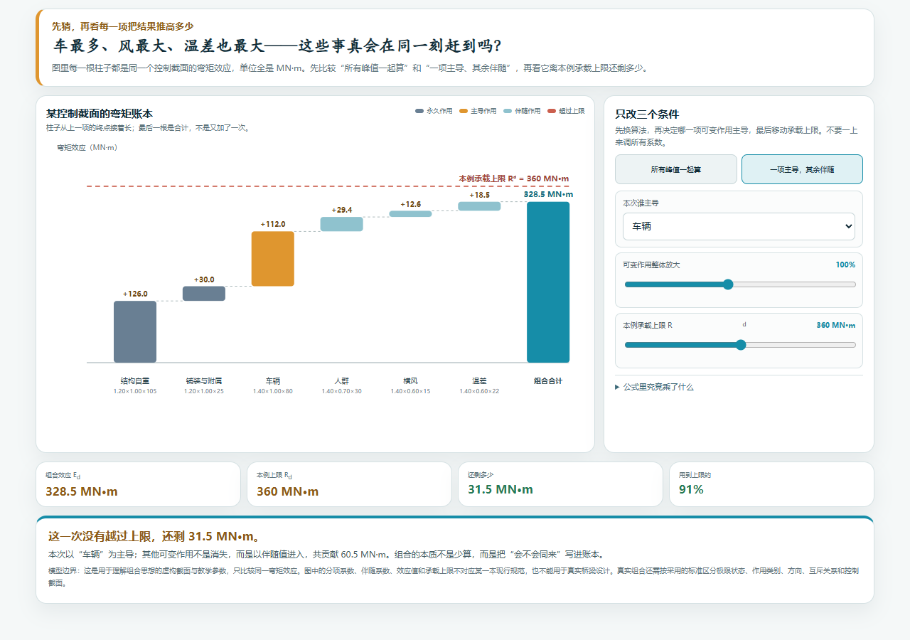
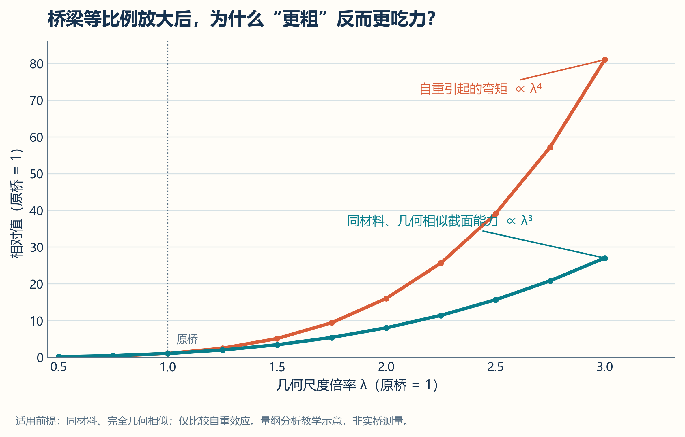
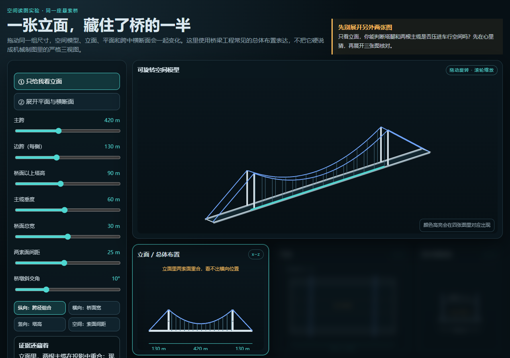
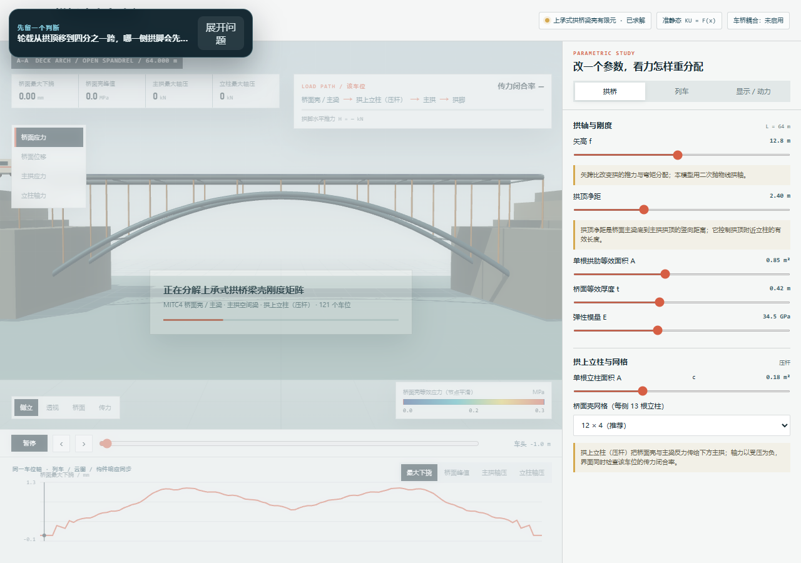
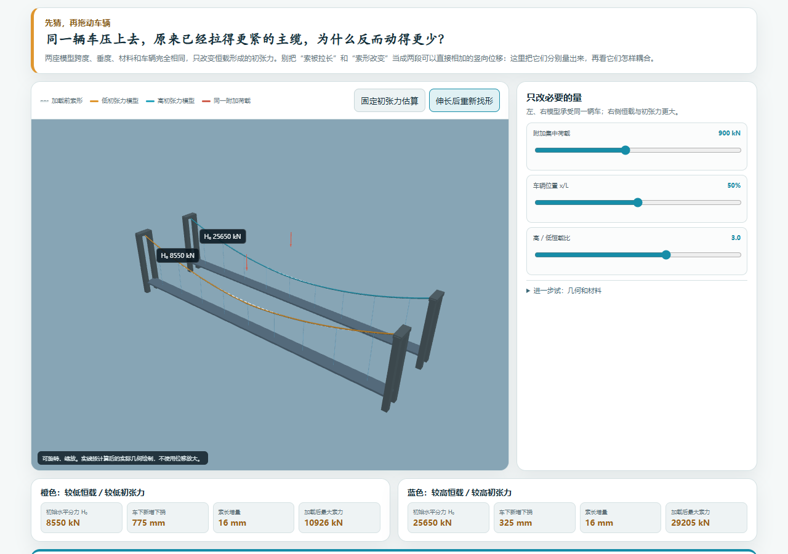
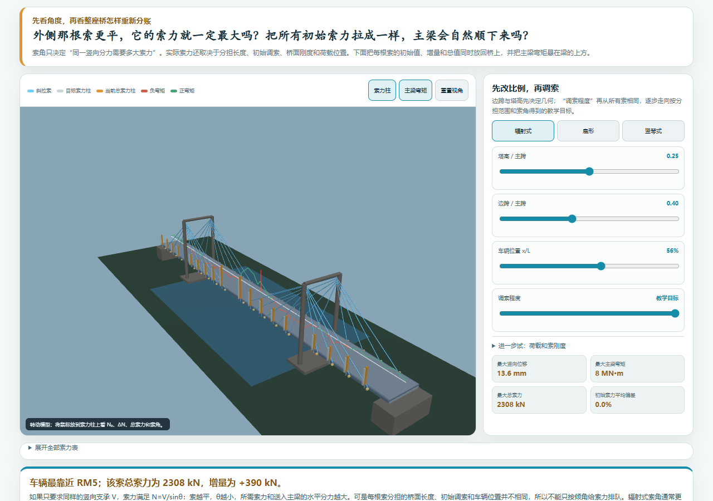
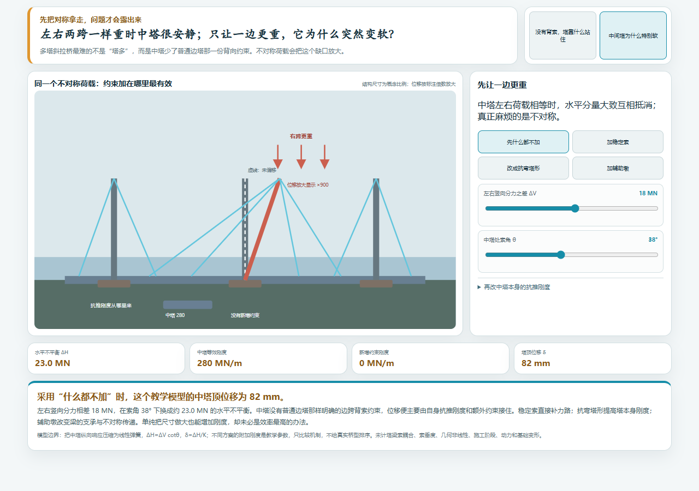
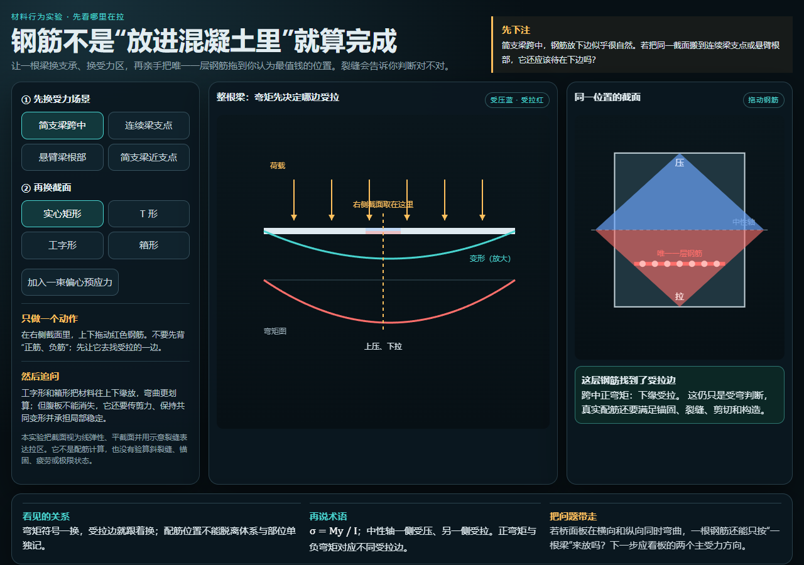
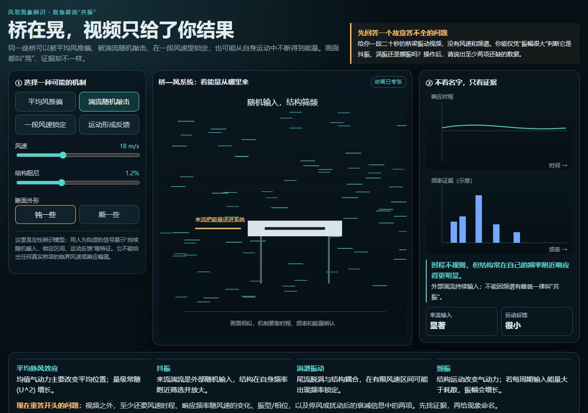
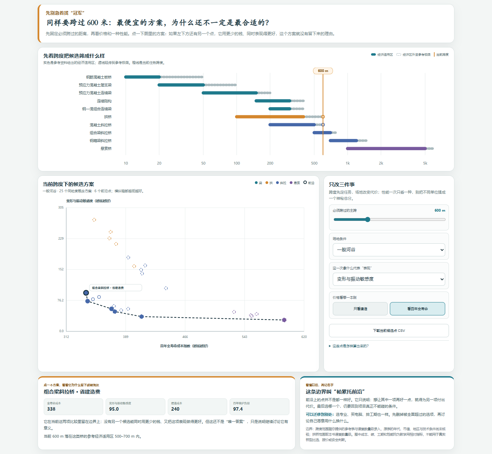

# 先动手看看 {.unnumbered}

从一个暂时答不准的问题开始。点开一项，转一转、拖一拖，再回来看看自己的第一反应有没有变。

:::: {.content-visible unless-format="epub"}

<a class="experience-card experience-card--wide" href="interactive/04-where-to-park.html" target="_blank">
  
  
    影响线
    <strong>一辆车到底停在哪儿，才会让你正在看的位置最难受？</strong>
    拖动车辆，不背固定答案。
  
</a>

<a class="experience-card" href="interactive/03-resistance-load-reliability-lab.html" target="_blank">
  
  
    可靠度
    <strong>桥不是“绝对安全”，那工程师究竟在控制什么？</strong>
    转动三维分布，找到失效的那一侧。
  
</a>

<a class="experience-card experience-card--wide" href="interactive/03-load-combination-waterfall.html" target="_blank">
  
  
    荷载组合
    <strong>车最多、风最大、温差也最大——真会在同一刻赶到吗？</strong>
    让每一项把弯矩推向上限，看清谁主导、谁伴随。
  
</a>

<a class="experience-card" href="interactive/fundamentals-lab.html?mode=scale" target="_blank">
  
  
    尺度效应
    <strong>把一座桥等比例放大十倍，它还会像原来一样工作吗？</strong>
    改一个尺度，看两条增长规律分开。
  
</a>

<a class="experience-card experience-card--wide" href="interactive/bridge-three-views.html" target="_blank">
  
  
    三视图
    <strong>一座三维的桥，为什么要拆成三张“看起来不完整”的图？</strong>
    在立面、平面和横断面里找同一个尺寸。
  
</a>

<a class="experience-card" href="interactive/arch-bridge-hybrid-fem.html" target="_blank">
  
  
    压力线
    <strong>拱看起来没有断，为什么一条看不见的线跑出去就危险了？</strong>
    改变荷载，把压力线推回拱圈里。
  
</a>

<a class="experience-card" href="interactive/08-cable-geometric-stiffness.html" target="_blank">
  
  
    几何刚度
    <strong>同一辆车，为什么原来拉得更紧的主缆反而动得更少？</strong>
    拆开索长变化与索形变化，再让它们重新耦合。
  
</a>

<a class="experience-card experience-card--wide" href="interactive/09-stay-force-moment-lab.html" target="_blank">
  
  
    初始调索
    <strong>把十八根索拉成一样，主梁会自己顺下来吗？</strong>
    索力柱立在锚点旁，弯矩图就悬在主梁上。
  
</a>

<a class="experience-card" href="interactive/09-special-system-balance.html" target="_blank">
  
  
    体系约束
    <strong>中塔两边一样重时很安静，为什么只重一边就突然变软？</strong>
    给缺失的约束找接班人，不靠记桥型。
  
</a>

<a class="experience-card" href="interactive/material-behavior-lab.html" target="_blank">
  
  
    材料分工
    <strong>混凝土怕拉，为什么钢筋不放在截面正中间？</strong>
    移动钢筋，看看内力臂和裂缝怎样变化。
  
</a>

<a class="experience-card" href="interactive/wind-phenomena-lab.html" target="_blank">
  
  
    风致振动
    <strong>风还没有最大，桥为什么会突然越晃越明显？</strong>
    调风、调阻尼，也调桥自己的节奏。
  
</a>

<a class="experience-card" href="interactive/modeling-lab.html?mode=fem" target="_blank">
  
  
    有限元
    <strong>网格切得越细，答案就一定越可信吗？</strong>
    从一根梁开始，亲手做一次收敛检查。
  
</a>

<a class="experience-card" href="interactive/11-bridge-pareto-front.html" target="_blank">
  
  
    多目标取舍
    <strong>同样跨 600 米，最便宜的方案为什么还不一定最合适？</strong>
    先固定跨度，再删掉同时更贵、表现也更差的方案。
  
</a>

::::

::: {.content-visible when-format="epub"}
这一页在网页版可以直接操作。EPUB 里先保留十三个问题，读到相应章节时，再到同一发布文件夹的网页版动手试：

1. 影响线：一辆车到底停在哪里，才会让正在看的位置最难受？
2. 可靠度：桥不是“绝对安全”，工程师究竟在控制什么？
3. 荷载组合：车最多、风最大、温差也最大，真会在同一刻赶到吗？
4. 尺度效应：把一座桥等比例放大十倍，它还会像原来一样工作吗？
5. 三视图：一座三维的桥，为什么要拆成三张“看起来不完整”的图？
6. 压力线：拱没有断，为什么一条看不见的线跑出去就危险了？
7. 几何刚度：同一辆车，为什么原来拉得更紧的主缆反而动得更少？
8. 初始调索：把十八根索拉成一样，主梁会自己顺下来吗？
9. 体系约束：中塔两边一样重时很安静，为什么只重一边就突然变软？
10. 材料分工：混凝土怕拉，为什么钢筋不放在截面正中间？
11. 风致振动：风还没有最大，桥为什么会突然越晃越明显？
12. 有限元：网格切得越细，答案就一定越可信吗？
13. 多目标取舍：同样跨 600 米，最便宜的方案为什么还不一定最合适？
:::

这些小实验不替你作判断。它们只是把原本藏在公式和计算书里的变化摆到眼前：先猜，再动手，再说清楚自己为什么改了主意。
